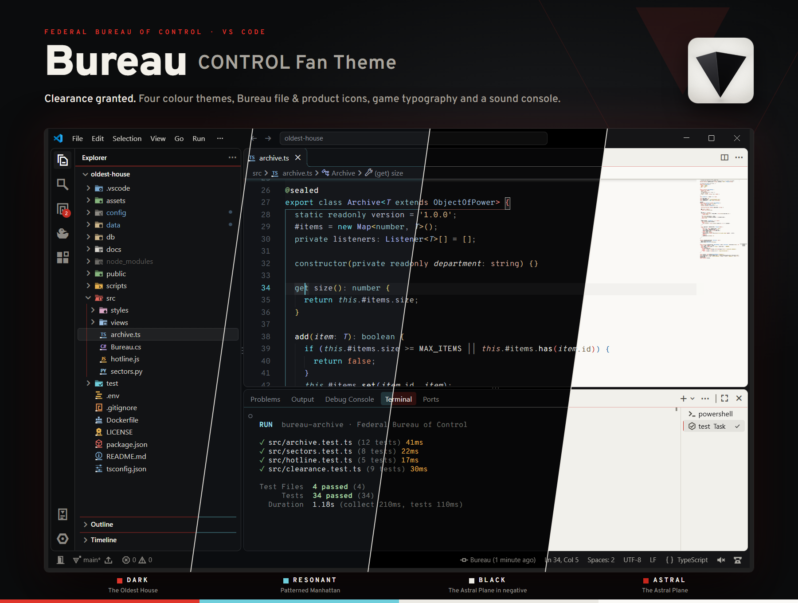
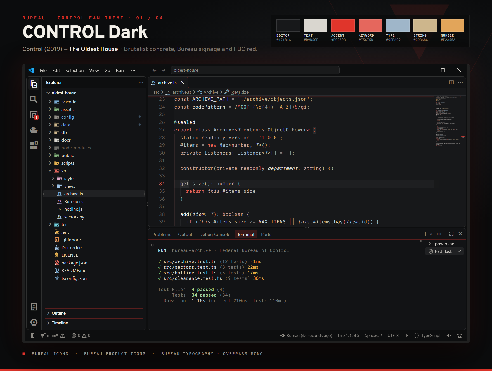
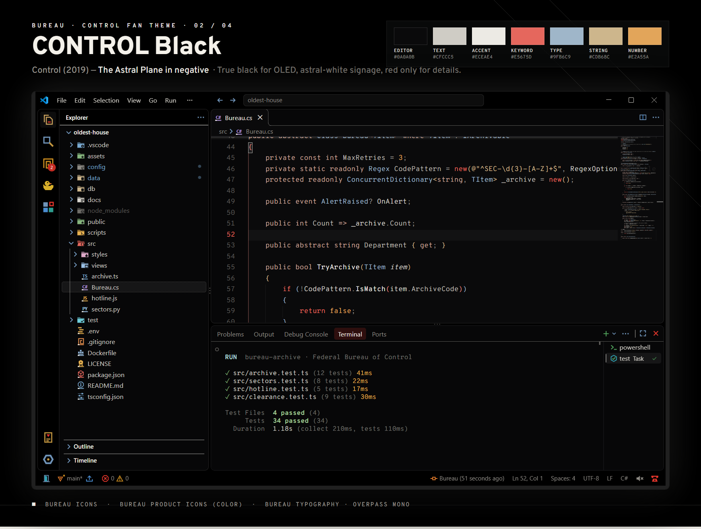
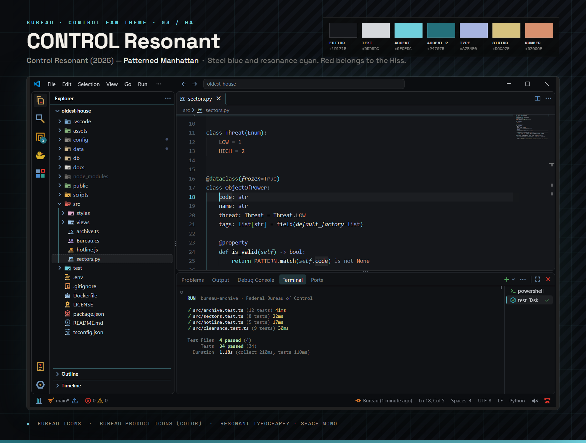
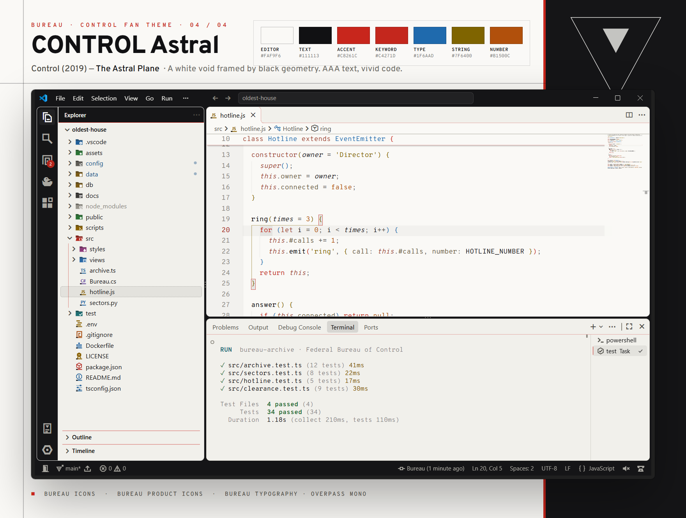
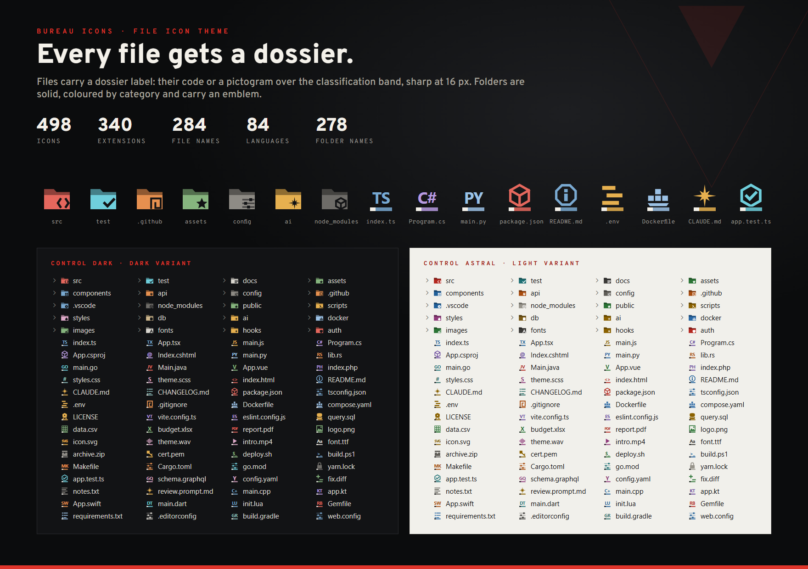
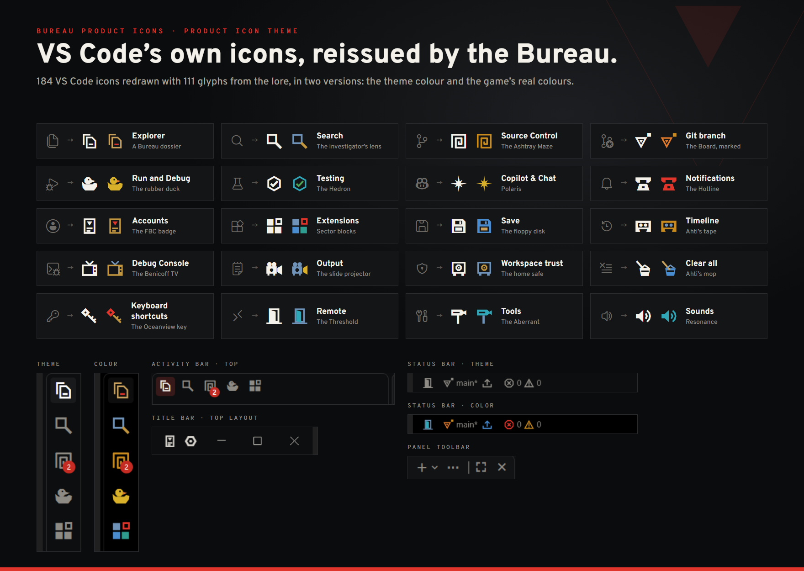
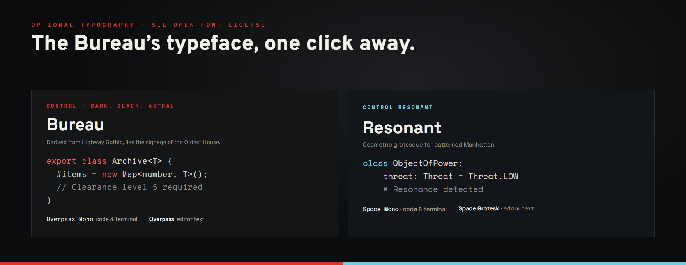
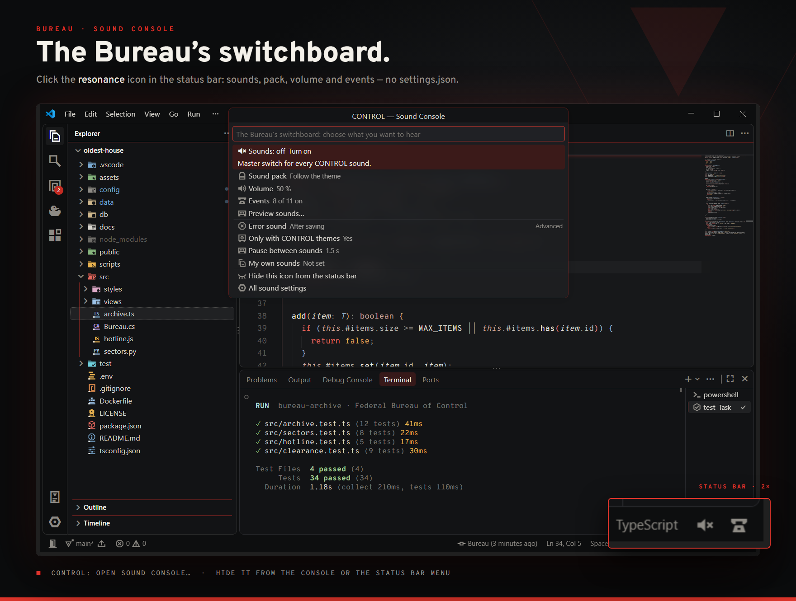

# Bureau — CONTROL Fan Theme

**[English](#english)** · **[Español](#español)**



**Clearance granted. Turn VS Code into the Federal Bureau of Control.**<br>
**Acceso autorizado. Convierte VS Code en la Agencia Federal de Control.**

*By **Normalxxnavi** · This is unofficial fan work not approved or endorsed by Remedy Entertainment Plc or its affiliates.*

---

<a id="english"></a>

# English

![CONTROL · Fan Edition][fan] ![CONTROL Resonant · Fan Edition][fan-resonant]

Bureau dresses Visual Studio Code in the brutalist world of the Federal Bureau of Control: the concrete of the Oldest House, the white void of the Astral Plane and the patterned Manhattan of *CONTROL Resonant*. It is not just a colour palette — the frame of the editor becomes Bureau signage, every file carries a dossier label, VS Code's own icons are reissued as Objects of Power, and the games' typography and sounds are one click away.

## What's inside

| | |
|---|---|
| ![4 colour themes][themes] | **CONTROL Dark** (The Oldest House), **CONTROL Black** (OLED), **CONTROL Resonant** (patterned Manhattan) and **CONTROL Astral** (the light Astral Plane). |
| ![Bureau Icons][file-icons] | 498 file and folder icons: 340 file extensions, 284 well-known file names, 84 languages and 278 folder names, in dark and light variants. |
| ![Bureau Product Icons][product-icons] | 184 of VS Code's own icons redrawn with 111 glyphs from the lore, in two versions: the theme colour or the game's **real colours**. |
| ![Typography][typography] | Free fonts inspired by the games for the editor, terminal and chat, installed only for your user. |
| ![Sound console][sounds] | Optional sound effects with a console in the status bar — no `settings.json` needed. |

## The themes

### CONTROL Dark — The Oldest House

![The Oldest House][oldest-house] ![FBC red #E0352B][fbc-red] ![WCAG contrast checked][wcag]



The reference theme, inspired by *Control* (2019). Warm charcoal concrete, bone-white text and **FBC red** as the accent — the colour of the Bureau's signage and of Jesse's Service Weapon. Red is used with restraint: the frame, the active elements and the control-flow keywords (`if`, `return`, `throw`), while declarations stay in muted tones so the code remains calm to read for hours.

### CONTROL Black — The Astral Plane in negative

![Astral Plane in negative][astral-negative] ![True black for OLED][oled]



True black for OLED screens. The signage lines, the cursor and the glows switch to **astral white**, as if the Astral Plane had been printed in negative; FBC red is kept only for the selection and small details. The darkest theme of the set, with the same contrast guarantees as CONTROL Dark. In the screenshot: the colour product icons.

### CONTROL Resonant — Patterned Manhattan

![Patterned Manhattan][manhattan] ![The Aberrant][aberrant] ![Red belongs to the Hiss][hiss]



Inspired by *Control Resonant* (2026), where Dylan Faden crosses a Manhattan of floating, rotated buildings: cold wet-asphalt greys, steel blue and the pale **resonance cyan**. Following the game's art direction, **red belongs to the Hiss** — it only appears for errors and deletions, so when you see red, something really is wrong. Pairs with the *Resonant* typography (Space Mono and Space Grotesk).

### CONTROL Astral — The Astral Plane

![The Astral Plane][astral-plane] ![Text WCAG AAA][wcag-aaa]



The only light theme: a white void framed by black geometry, like the Astral Plane, with FBC red reserved for small details. Body text reaches 16.8:1 (**AAA**) and the code colours — red keywords, blue types, ochre strings, orange numbers — are vivid enough to tell apart from the black text at a glance, while staying above 4.5:1 (**AA**).

### More than colours: Bureau signage

- **The monolith.** The activity bar, status bar and title bar form a dark block — also in Astral — that holds the editor, the sidebar and the panel.
- **Signage headers.** Sidebar titles are monolith bands with an accent line underneath; sections are separated by thin accent rules.
- **Astral light.** Active elements of the frame glow in pure white, like the light of the Astral Plane.
- **Accent glow.** Floating widgets and the edge of scrolled content glow with the theme colour: FBC red, resonance cyan or astral white.
- **Editor details.** The current line number, the active indent guide, matching brackets and rulers use the accent; the line-number gutter is a darker concrete band.
- **Full coverage.** 687 UI colour keys (including the *modern UI* of VS Code 1.140), the terminal's 16 ANSI colours, Git, diff and merge editors, bracket pairs and **semantic highlighting** (including C#/Roslyn and Razor). Every text colour is checked against WCAG before packaging.

## Install

![Clearance granted][clearance]

1. Install **Bureau — CONTROL Fan Theme** from the Marketplace (or run `code --install-extension bureau-theme-<version>.vsix`).
2. Press <kbd>Ctrl</kbd>+<kbd>K</kbd> <kbd>Ctrl</kbd>+<kbd>T</kbd> (<kbd>Cmd</kbd>+<kbd>K</kbd> <kbd>Cmd</kbd>+<kbd>T</kbd> on macOS) and pick **CONTROL Dark**, **CONTROL Black**, **CONTROL Resonant** or **CONTROL Astral**.
3. Run **Preferences: File Icon Theme** → **Bureau Icons**.
4. Run **Preferences: Product Icon Theme** → **Bureau Product Icons** (theme colour) or **Bureau Product Icons (Color)** (the game's real colours).
5. The first time the extension starts it offers the game typography; the sound console is the ![Resonance][lore-resonance] icon in the status bar.

## Bureau Icons



Every file carries the label of a **Bureau dossier**: its code (`TS`, `C#`, `PY`…) or a pictogram in the colour of its language, over a classification band with an astral notch — large, pixel-aligned shapes that stay sharp at 16 px. Every folder is solid, coloured by category and carries an emblem: `</>` for `src`, a check for `test`, a mountain for `images`, a hex nut for `.vscode`, a cube for `node_modules`, a globe for `l10n`…

- ![The Oldest House][lore-house] The root folder of a multi-root workspace is the Oldest House itself.
- ![Ashtray Maze][lore-maze] `.git`, `.gitignore` and friends carry the Ashtray Maze — every branch leads somewhere.
- ![Polaris][lore-polaris] AI instruction files (`CLAUDE.md`, `AGENTS.md`, `*.prompt.md`…) carry Polaris, the light that guides Jesse.
- `.env` files are a **classified, redacted document**; tests carry the **Hedron**.

Coverage: programming languages, web, .NET (`.csproj`, `.sln`, `appsettings.json`…), configuration for the usual tools (Vite, Webpack, ESLint, Prettier, Jest, Vitest, Playwright, Tailwind, Next, Nuxt, Angular…), package managers and lockfiles, Docker and CI files, documents, images, audio, video, fonts, archives, certificates and keys.

## Bureau Product Icons



VS Code's own icons, reissued by the Bureau: geometric, brutalist glyphs (octagons instead of circles, square dots, thick strokes) that work with the activity bar on the side, on top or at the bottom. Two themes are included:

- **Bureau Product Icons** — every icon in the theme colour, like VS Code's own icons.
- **Bureau Product Icons (Color)** — **every** icon in colour: the objects in their real colours and the interface in the Bureau's steel blue, with green for go, amber for caution and red for stop. It is a colour font (COLR/CPAL), so the colours are fixed and do not dim when inactive.

### Objects of Power in your toolbar

| From the game | In VS Code |
|---|---|
| ![Bureau dossier][lore-dossier] | Explorer |
| ![Ashtray Maze][lore-maze] | Source Control and merges |
| ![The Board][lore-board] | The Git branch in the status bar — marked amber with changes, green when staged, red on conflicts |
| ![Rubber duck][lore-duck] | Run and Debug — the teleporting Altered Item, for rubber duck debugging |
| ![Hedron][lore-hedron] | Testing |
| ![Polaris][lore-polaris] | Copilot, chat and AI |
| ![The Hotline][lore-hotline] | Notifications |
| ![FBC badge][lore-badge] | Accounts |
| ![Floppy disk][lore-floppy] | Save — the Object of Power the Bureau took from the Russians |
| ![Ahti's tape][lore-cassette] | Timeline and history |
| ![Benicoff TV][lore-tv] | Debug Console |
| ![Slide projector][lore-projector] | Output |
| ![Home safe][lore-safe] | Workspace trust and archives |
| ![Ahti's mop][lore-mop] | Clear all |
| ![Oceanview Motel key][lore-key] | Keys and keyboard shortcuts |
| ![The Oldest House][lore-house] | Home |
| ![The Threshold][lore-threshold] | Remote connections |
| ![The Aberrant][lore-aberrant] | Tools — Dylan's shape-shifting weapon from *CONTROL Resonant* |
| ![Songmaster Jukebox][lore-jukebox] | Music and sound packs |
| ![Object of Power][lore-cube] | Packages |
| ![Resonance][lore-resonance] | The sound console in the status bar |

Plus the whole interface: panels (new, split, kill, maximize, close, more actions), trees (chevrons, new file and folder, refresh, collapse all, filter), the title bar (back and forward, layout toggles, window controls), the debug toolbar, errors, warnings and the remote indicator. Only icons that VS Code identifies by name can be replaced; extensions that draw their own image keep it.

## Typography

![Typography][typography]



*Control* is set in commercial typefaces (Interstate for signage and interface, ITC Avant Garde Gothic for titles, Akzidenz-Grotesk for documents), so they cannot be bundled. The extension includes free alternatives under the SIL Open Font License and offers them the first time it starts:

| Option | Code (editor, terminal, debug console, code in chat) | Text (chat, Markdown preview) |
|---|---|---|
| **Bureau** (*Control*) | **Overpass Mono** — derived from *Highway Gothic*, the road-sign lettering Interstate is based on | **Overpass** |
| **Resonant** (*Control Resonant*) | **Space Mono** — geometric and retro-futuristic | **Space Grotesk** |
| **Follow the theme** | Resonant with CONTROL Resonant, Bureau with the other CONTROL themes, your own font with any other theme | |

- If you own **Interstate Mono** or **Interstate**, the Bureau option uses them first.
- The fonts are installed **only for your user**, without administrator rights. Restart VS Code once after choosing.
- **Keep my font** restores your previous settings; **CONTROL: Remove Installed Fonts** also deletes the font files.

## Sounds and the sound console

![Sound console][sounds] ![Songmaster Jukebox][lore-jukebox] ![The Hotline][lore-hotline]



Short sound effects inspired by both games, **off by default**. You never need to edit `settings.json`: click the ![Resonance][lore-resonance] **resonance** icon in the status bar (or run **CONTROL: Open Sound Console…**) and the Bureau's switchboard lets you:

- turn the sounds on or off;
- pick the pack — *Control*, *Resonant* or *follow the theme*;
- set the volume (it plays a sample so you can hear it);
- tick, one by one, the moments that should make a sound;
- preview every sound;
- and, under *Advanced*: when to sound for errors, whether to play only with CONTROL themes, the pause between sounds and a folder with your own sounds.

Experienced users can hide the icon from the console itself, with **CONTROL: Show/Hide Sound Icon in Status Bar**, by right-clicking the status bar, or with `"bureauTheme.sounds.statusBarItem": false`.

| Event | Default | Control pack | Resonant pack |
|---|---|---|---|
| VS Code starts | off | Low concrete hum of the Oldest House | Distant, warped city |
| Switching to a CONTROL theme | on | Old red-phone ring | Hedron pulse |
| Manual save (auto-save is ignored) | off | Rubber stamp | Metallic tick |
| New errors | on | Hiss-like whisper | Whisper with patterned echoes |
| Last error fixed | on | Control Point cleansed | Resonant defeated |
| Task or build succeeded | on | Elevator ding | Rising glass arpeggio |
| Task or build failed | on | Bureau alert | Gravity distortion |
| Terminal command failed | off | Radio static | Glitched static |
| Debugging started | on | Service Weapon transformation | Shape-shifting weapon |
| Breakpoint hit | on | Slide projector | Gravity shift |
| Git commit | on | Typewriter and bell | Metal hit with echoes |

**All sounds are original recreations** synthesized from scratch — no audio, music or voices from the games are included or downloaded. See [`sounds/LICENSES.md`](sounds/LICENSES.md). VS Code has no audio API for extensions, so the extension uses the system player (PowerShell on Windows, `afplay` on macOS, `paplay`, `pw-play` or `aplay` on Linux); with Remote-SSH, WSL or Codespaces the sounds play on your local machine.

## Settings

| Setting | Default | Description |
|---|---|---|
| `bureauTheme.font` | `none` | `bureau`, `resonant`, `auto` (follow the theme) or `none` (keep your font). |
| `bureauTheme.sounds.enabled` | `false` | Master switch for sounds. |
| `bureauTheme.sounds.statusBarItem` | `true` | Show the sound console icon in the status bar. |
| `bureauTheme.sounds.pack` | `auto` | `auto` follows the theme, or force `control` or `resonant`. |
| `bureauTheme.sounds.volume` | `50` | 0–100. |
| `bureauTheme.sounds.onlyWithControlTheme` | `true` | Stay silent while another theme is active. |
| `bureauTheme.sounds.errorTrigger` | `onSave` | `onSave` or `live`. |
| `bureauTheme.sounds.cooldownMs` | `1500` | Minimum time between sounds; more important ones can interrupt. |
| `bureauTheme.sounds.customFolder` | `""` | Folder with your own `.wav` files (`startup.wav`, `theme.wav`, `save.wav`, `error.wav`, `clear.wav`, `build-ok.wav`, `build-fail.wav`, `terminal-fail.wav`, `debug.wav`, `breakpoint.wav`, `commit.wav`). |
| `bureauTheme.sounds.events.*` | see above | One switch per event. |

Comments, parameters and type parameters are *italic*. To turn italics off:

```jsonc
{
  "editor.tokenColorCustomizations": {
    "[CONTROL Dark][CONTROL Black][CONTROL Resonant][CONTROL Astral]": {
      "textMateRules": [
        {
          "scope": ["comment", "variable.parameter", "entity.name.type.type-parameter", "variable.language", "markup.quote"],
          "settings": { "fontStyle": "" }
        }
      ]
    }
  },
  "editor.semanticTokenColorCustomizations": {
    "[CONTROL Dark][CONTROL Black][CONTROL Resonant][CONTROL Astral]": {
      "rules": { "parameter": { "italic": false }, "typeParameter": { "italic": false }, "*.abstract": { "italic": false } }
    }
  }
}
```

## How it's made

![JavaScript][tool-js] ![Node.js][tool-node] ![esbuild][tool-esbuild] ![Claude Code][tool-claude] ![0 runtime dependencies][tool-deps]

Everything in the pack is generated by code — no drawing programs and no assets taken from the games.

| Part | How it is made |
|---|---|
| Colour themes | Role-based palettes turned into 687 UI colours, TextMate rules and semantic tokens by a Node.js script; every colour pair is checked against WCAG before packaging. |
| Bureau Icons | 498 SVG icons written by a script on a 16 px grid, with dark and light variants. |
| Bureau Product Icons | 111 glyphs drawn as polygons on a 24 px grid and turned into an icon font (svgicons2svgfont → svg2ttf → ttf2woff). The colour version adds COLR/CPAL colour tables written by the project. |
| Extension icon | Rendered pixel by pixel with 4×4 supersampling and saved with a tiny PNG encoder written for the project. |
| Sounds | Synthesized from scratch in JavaScript (oscillators, noise and envelopes) — no samples. |
| Extension code | JavaScript checked with TypeScript (`// @ts-check` + JSDoc), bundled with esbuild into one file with no runtime dependencies. The sound console, the audio engine and the font installer only load when used: the extension's own work at start-up takes a few milliseconds. |
| Quality | Unit tests (`node:test`) and an integration test that drives a real VS Code (sounds, sound console, typography, tasks, debugging, Git). |
| Screenshots | Taken from a real VS Code with a demo project, framed with HTML and rendered with a headless browser. |

## Tested languages and known limitations

C#, Razor, JavaScript, TypeScript, JSON, HTML, CSS, SCSS, SQL, Markdown, XML, YAML, Python, Bash, diff and Git merge conflicts.

- Semantic colours depend on each language extension (for C# and Razor, the official C# extension).
- The theme colours the Markdown **editor**; the Markdown **preview** uses its own stylesheet.
- Panels from other extensions (for example AI chat panels) are web views and only follow the theme colours they choose to use.
- On Linux, sounds need `paplay`, `pw-play` or `aplay`; the *terminal command failed* sound requires shell integration.

See the [CHANGELOG](CHANGELOG.md) for the release history.

## Credits and disclaimer

![CONTROL · Fan Edition][fan]

Made by **Normalxxnavi**. Fonts: Overpass, Overpass Mono, Space Mono and Space Grotesk (SIL Open Font License, see [`fonts/`](fonts/README.md)). Everything else — colours, icons, glyphs and sounds — is original and released under the [MIT license](LICENSE).

**This is unofficial fan work not approved or endorsed by Remedy Entertainment Plc or its affiliates.** CONTROL and CONTROL Resonant are trademarks of their respective owners and are only used to describe what inspired this theme. It is free and has no commercial purpose. No game assets (images, logos, audio, music, fonts or text) are included.

**[Back to top](#bureau--control-fan-theme)** · **[Español](#español)**

---

<a id="español"></a>

# Español

![CONTROL · Edición fan][fan-es] ![CONTROL Resonant · Edición fan][fan-resonant-es]

Bureau viste Visual Studio Code con el mundo brutalista de la Agencia Federal de Control: el hormigón de la Casa Inmemorial, el vacío blanco del Plano Astral y el Manhattan alterado de *CONTROL Resonant*. No es solo una paleta de colores: el marco del editor se convierte en señalética de la Agencia, cada archivo lleva la etiqueta de un expediente, los iconos del propio VS Code se reeditan como Objetos de Poder, y la tipografía y los sonidos de los juegos están a un clic.

## Qué incluye

| | |
|---|---|
| ![4 temas de color][themes-es] | **CONTROL Dark** (la Casa Inmemorial), **CONTROL Black** (OLED), **CONTROL Resonant** (el Manhattan alterado) y **CONTROL Astral** (el Plano Astral, tema claro). |
| ![Bureau Icons][file-icons-es] | 498 iconos de archivos y carpetas: 340 extensiones, 284 nombres de archivo conocidos, 84 lenguajes y 278 nombres de carpeta, con variantes oscura y clara. |
| ![Bureau Product Icons][product-icons-es] | 184 iconos del propio VS Code redibujados con 111 glifos del lore, en dos versiones: el color del tema o los **colores reales** del juego. |
| ![Tipografía][typography-es] | Fuentes libres inspiradas en los juegos para el editor, la terminal y el chat, instaladas solo para tu usuario. |
| ![Consola de sonido][sounds-es] | Efectos de sonido opcionales con una consola en la barra de estado: sin tocar `settings.json`. |

## Los temas

### CONTROL Dark — La Casa Inmemorial

![La Casa Inmemorial][oldest-house-es] ![Rojo FBC #E0352B][fbc-red-es] ![Contraste WCAG verificado][wcag-es]


El tema de referencia, inspirado en *Control* (2019). Hormigón gris carbón cálido, texto color hueso y **rojo FBC** como acento: el color de la señalética de la Agencia y del Arma de Servicio de Jesse. El rojo se usa con moderación: el marco, los elementos activos y las palabras clave de control de flujo (`if`, `return`, `throw`), mientras que las declaraciones van en tonos apagados para que el código se lea con calma durante horas.

### CONTROL Black — El Plano Astral en negativo

![Plano Astral en negativo][astral-negative-es] ![Negro puro para OLED][oled-es]


Negro puro para pantallas OLED. Las líneas de señalética, el cursor y los brillos pasan a **blanco astral**, como si el Plano Astral se hubiera impreso en negativo; el rojo FBC queda solo para la selección y pequeños detalles. Es el tema más oscuro del conjunto, con las mismas garantías de contraste que CONTROL Dark. En la captura: los iconos de producto a color.

### CONTROL Resonant — El Manhattan alterado

![Manhattan alterado][manhattan-es] ![El Aberrante][aberrant-es] ![El rojo es del Hiss][hiss-es]


Inspirado en *Control Resonant* (2026), donde Dylan Faden recorre un Manhattan de edificios que flotan girados: grises fríos de asfalto mojado, azul acero y el **cian de resonancia** pálido. Siguiendo la dirección de arte del juego, **el rojo pertenece al Hiss**: solo aparece en errores y eliminaciones, así que cuando ves rojo, algo va mal de verdad. Combina con la tipografía *Resonant* (Space Mono y Space Grotesk).

### CONTROL Astral — El Plano Astral

![El Plano Astral][astral-plane-es] ![Texto WCAG AAA][wcag-aaa-es]


El único tema claro: un vacío blanco enmarcado por geometría negra, como el Plano Astral, con el rojo FBC reservado para pequeños detalles. El texto llega a 16,8:1 (**AAA**) y los colores del código (palabras clave rojas, tipos azules, cadenas ocre, números naranjas) son lo bastante vivos para distinguirlos del texto negro de un vistazo, sin bajar de 4,5:1 (**AA**).

### Más que colores: la señalética de la Agencia

- **El monolito.** La barra de actividad, la barra de estado y la barra de título forman un bloque oscuro (también en Astral) que sostiene el editor, la barra lateral y el panel.
- **Cabeceras de señalética.** Los títulos de la barra lateral son bandas de monolito con una línea de acento debajo; las secciones se separan con finas líneas de acento.
- **Luz astral.** Los elementos activos del marco brillan en blanco puro, como la luz del Plano Astral.
- **Brillo de acento.** Los elementos flotantes y el borde del contenido desplazado brillan con el color del tema: rojo FBC, cian de resonancia o blanco astral.
- **Detalles del editor.** El número de la línea actual, la guía de sangría activa, los corchetes emparejados y las reglas usan el acento; el margen de números de línea es una franja de hormigón más oscura.
- **Cobertura completa.** 687 claves de color de la interfaz (incluida la *interfaz moderna* de VS Code 1.140), los 16 colores ANSI de la terminal, Git, editores de diferencias y fusión, pares de corchetes y **resaltado semántico** (incluidos C#/Roslyn y Razor). Todos los colores de texto se comprueban con WCAG antes de empaquetar.

## Instalación

![Acceso autorizado][clearance-es]

1. Instala **Bureau — CONTROL Fan Theme** desde el Marketplace (o ejecuta `code --install-extension bureau-theme-<versión>.vsix`).
2. Pulsa <kbd>Ctrl</kbd>+<kbd>K</kbd> <kbd>Ctrl</kbd>+<kbd>T</kbd> (<kbd>Cmd</kbd>+<kbd>K</kbd> <kbd>Cmd</kbd>+<kbd>T</kbd> en macOS) y elige **CONTROL Dark**, **CONTROL Black**, **CONTROL Resonant** o **CONTROL Astral**.
3. Ejecuta **Preferencias: Tema de icono de archivo** → **Bureau Icons**.
4. Ejecuta **Preferencias: Tema de icono de producto** → **Bureau Product Icons** (color del tema) o **Bureau Product Icons (Color)** (los colores reales del juego).
5. La primera vez que se inicia, la extensión ofrece la tipografía de los juegos; la consola de sonido es el icono ![Resonancia][lore-resonance-es] de la barra de estado.

## Bureau Icons


Cada archivo lleva la etiqueta de un **expediente de la Agencia**: su código (`TS`, `C#`, `PY`…) o un pictograma del color de su lenguaje, sobre una banda de clasificación con su muesca astral; formas grandes y alineadas a los píxeles para que se vean nítidas a 16 px. Cada carpeta es maciza, del color de su categoría, y lleva un emblema: `</>` para `src`, un check para `test`, una montaña para `images`, una tuerca para `.vscode`, un cubo para `node_modules`, un globo para `l10n`…

- ![La Casa Inmemorial][lore-house-es] La carpeta raíz de un área de trabajo con varias raíces es la propia Casa Inmemorial.
- ![Laberinto del Cenicero][lore-maze-es] `.git`, `.gitignore` y compañía llevan el Laberinto del Cenicero: cada rama lleva a algún sitio.
- ![Polaris][lore-polaris-es] Los archivos de instrucciones para IA (`CLAUDE.md`, `AGENTS.md`, `*.prompt.md`…) llevan a Polaris, la luz que guía a Jesse.
- Los `.env` son un **documento clasificado y censurado**; los tests llevan el **Hedrón**.

Cobertura: lenguajes de programación, web, .NET (`.csproj`, `.sln`, `appsettings.json`…), configuración de las herramientas habituales (Vite, Webpack, ESLint, Prettier, Jest, Vitest, Playwright, Tailwind, Next, Nuxt, Angular…), gestores de paquetes y archivos de bloqueo, Docker y CI, documentos, imágenes, audio, vídeo, fuentes, archivos comprimidos, certificados y claves.

## Bureau Product Icons


Los iconos del propio VS Code, reeditados por la Agencia: glifos geométricos y brutalistas (octógonos en lugar de círculos, puntos cuadrados, trazos gruesos) que funcionan con la barra de actividad a un lado, arriba o abajo. Incluye dos temas:

- **Bureau Product Icons**: todos los iconos en el color del tema, como los del propio VS Code.
- **Bureau Product Icons (Color)**: **todos** los iconos a color: los objetos con sus colores reales y la interfaz en el azul acero de la Agencia, con verde para seguir, ámbar para precaución y rojo para parar. Es una fuente de color (COLR/CPAL), así que los colores son fijos y no se atenúan cuando el icono está inactivo.

### Objetos de Poder en tu barra de herramientas

| Del juego | En VS Code |
|---|---|
| ![Expediente][lore-dossier-es] | Explorador |
| ![Laberinto del Cenicero][lore-maze-es] | Control de código fuente y fusiones |
| ![El Consejo][lore-board-es] | La rama de Git en la barra de estado: marca ámbar con cambios, verde con cambios preparados y roja con conflictos |
| ![Patito de goma][lore-duck-es] | Ejecutar y depurar: el Objeto Alterado que se teletransporta, para el *rubber duck debugging* |
| ![Hedrón][lore-hedron-es] | Pruebas |
| ![Polaris][lore-polaris-es] | Copilot, el chat y la IA |
| ![La Línea Directa][lore-hotline-es] | Notificaciones |
| ![Placa de la FBC][lore-badge-es] | Cuentas |
| ![Disquete][lore-floppy-es] | Guardar: el Objeto de Poder que la Agencia se llevó de los rusos |
| ![La cinta de Ahti][lore-cassette-es] | Línea de tiempo e historial |
| ![Televisión Benicoff][lore-tv-es] | Consola de depuración |
| ![Proyector de diapositivas][lore-projector-es] | Salida |
| ![Caja fuerte][lore-safe-es] | Confianza del área de trabajo y archivos |
| ![La fregona de Ahti][lore-mop-es] | Borrar todo |
| ![Llave del Motel Oceanview][lore-key-es] | Claves y atajos de teclado |
| ![La Casa Inmemorial][lore-house-es] | Inicio |
| ![El Umbral][lore-threshold-es] | Conexiones remotas |
| ![El Aberrante][lore-aberrant-es] | Herramientas: el arma que cambia de forma de Dylan en *CONTROL Resonant* |
| ![Gramola Songmaster][lore-jukebox-es] | Música y packs de sonido |
| ![Objeto de Poder][lore-cube-es] | Paquetes |
| ![Resonancia][lore-resonance-es] | La consola de sonido de la barra de estado |

Y toda la interfaz: paneles (nuevo, dividir, cerrar proceso, maximizar, cerrar, más acciones), árboles (flechas, nuevo archivo y carpeta, actualizar, contraer todo, filtrar), la barra de título (atrás y adelante, botones de diseño, controles de ventana), la barra de depuración, errores, advertencias y el indicador remoto. Solo se pueden sustituir los iconos que VS Code identifica por su nombre; las extensiones que dibujan su propia imagen la mantienen.

## Tipografía

![Tipografía][typography-es]


*Control* usa tipografías comerciales (Interstate para la señalética y la interfaz, ITC Avant Garde Gothic para los títulos, Akzidenz-Grotesk para los documentos), así que no se pueden incluir. La extensión trae alternativas libres con licencia SIL Open Font License y las ofrece la primera vez que se inicia:

| Opción | Código (editor, terminal, consola de depuración, código en el chat) | Texto (chat, vista previa de Markdown) |
|---|---|---|
| **Bureau** (*Control*) | **Overpass Mono**: derivada de *Highway Gothic*, la rotulación de carreteras en la que se basa Interstate | **Overpass** |
| **Resonant** (*Control Resonant*) | **Space Mono**: geométrica y retrofuturista | **Space Grotesk** |
| **Según el tema** | Resonant con CONTROL Resonant, Bureau con los demás temas CONTROL y tu propia fuente con cualquier otro tema | |

- Si tienes **Interstate Mono** o **Interstate**, la opción Bureau las usa primero.
- Las fuentes se instalan **solo para tu usuario**, sin permisos de administrador. Reinicia VS Code una vez después de elegir.
- **Mantener mi fuente** restaura tu configuración anterior; **CONTROL: Quitar las tipografías instaladas** borra además los archivos.

## Sonidos y consola de sonido

![Consola de sonido][sounds-es] ![Gramola Songmaster][lore-jukebox-es] ![La Línea Directa][lore-hotline-es]


Efectos de sonido cortos inspirados en los dos juegos, **desactivados por defecto**. No hace falta tocar `settings.json`: pulsa el icono de la ![Resonancia][lore-resonance-es] **resonancia** en la barra de estado (o ejecuta **CONTROL: Abrir la consola de sonido…**) y la centralita de la Agencia te deja:

- activar o desactivar los sonidos;
- elegir el pack: *Control*, *Resonant* o *según el tema*;
- ajustar el volumen (suena una muestra para que lo oigas);
- marcar uno a uno los momentos que deben sonar;
- probar todos los sonidos;
- y, en *Avanzado*: cuándo suenan los errores, si solo suenan con temas CONTROL, la pausa entre sonidos y una carpeta con tus propios sonidos.

Si ya te manejas bien, puedes ocultar el icono desde la propia consola, con **CONTROL: Mostrar/ocultar el icono de sonido en la barra de estado**, con el botón derecho sobre la barra de estado o con `"bureauTheme.sounds.statusBarItem": false`.

| Evento | Por defecto | Pack Control | Pack Resonant |
|---|---|---|---|
| Se inicia VS Code | no | Zumbido grave del hormigón de la Casa Inmemorial | Ciudad lejana y distorsionada |
| Cambiar a un tema CONTROL | sí | Timbre del viejo teléfono rojo | Pulso del Hedrón |
| Guardado manual (se ignora el guardado automático) | no | Sello de goma | Tic metálico |
| Nuevos errores | sí | Susurro del Hiss | Susurro con ecos alterados |
| Último error corregido | sí | Punto de Control purificado | Resonante derrotado |
| Tarea o compilación correcta | sí | Campanilla del ascensor | Arpegio de cristal ascendente |
| Tarea o compilación fallida | sí | Alerta de la Agencia | Distorsión gravitatoria |
| Falla un comando de la terminal | no | Estática de radio | Estática con glitch |
| Empieza la depuración | sí | Transformación del Arma de Servicio | Arma que cambia de forma |
| Se alcanza un punto de interrupción | sí | Proyector de diapositivas | Cambio de gravedad |
| Commit de Git | sí | Máquina de escribir y campanilla | Golpe metálico con ecos |

**Todos los sonidos son recreaciones originales** sintetizadas desde cero: no se incluye ni se descarga audio, música ni voces de los juegos. Consulta [`sounds/LICENSES.md`](sounds/LICENSES.md). VS Code no tiene una API de audio para extensiones, así que la extensión usa el reproductor del sistema (PowerShell en Windows, `afplay` en macOS, `paplay`, `pw-play` o `aplay` en Linux); con Remote-SSH, WSL o Codespaces los sonidos suenan en tu equipo local.

## Configuración

| Ajuste | Por defecto | Descripción |
|---|---|---|
| `bureauTheme.font` | `none` | `bureau`, `resonant`, `auto` (según el tema) o `none` (mantener tu fuente). |
| `bureauTheme.sounds.enabled` | `false` | Interruptor general de los sonidos. |
| `bureauTheme.sounds.statusBarItem` | `true` | Muestra el icono de la consola de sonido en la barra de estado. |
| `bureauTheme.sounds.pack` | `auto` | `auto` sigue al tema; también puedes forzar `control` o `resonant`. |
| `bureauTheme.sounds.volume` | `50` | De 0 a 100. |
| `bureauTheme.sounds.onlyWithControlTheme` | `true` | Silencio mientras esté activo otro tema. |
| `bureauTheme.sounds.errorTrigger` | `onSave` | `onSave` (al guardar) o `live` (en directo). |
| `bureauTheme.sounds.cooldownMs` | `1500` | Tiempo mínimo entre sonidos; los más importantes pueden interrumpir. |
| `bureauTheme.sounds.customFolder` | `""` | Carpeta con tus propios `.wav` (`startup.wav`, `theme.wav`, `save.wav`, `error.wav`, `clear.wav`, `build-ok.wav`, `build-fail.wav`, `terminal-fail.wav`, `debug.wav`, `breakpoint.wav`, `commit.wav`). |
| `bureauTheme.sounds.events.*` | ver arriba | Un interruptor por evento. |

Los comentarios, los parámetros y los parámetros de tipo van en *cursiva*. Para quitarla:

```jsonc
{
  "editor.tokenColorCustomizations": {
    "[CONTROL Dark][CONTROL Black][CONTROL Resonant][CONTROL Astral]": {
      "textMateRules": [
        {
          "scope": ["comment", "variable.parameter", "entity.name.type.type-parameter", "variable.language", "markup.quote"],
          "settings": { "fontStyle": "" }
        }
      ]
    }
  },
  "editor.semanticTokenColorCustomizations": {
    "[CONTROL Dark][CONTROL Black][CONTROL Resonant][CONTROL Astral]": {
      "rules": { "parameter": { "italic": false }, "typeParameter": { "italic": false }, "*.abstract": { "italic": false } }
    }
  }
}
```

## Cómo está hecho

![JavaScript][tool-js] ![Node.js][tool-node] ![esbuild][tool-esbuild] ![Claude Code][tool-claude] ![0 dependencias][tool-deps-es]

Todo el pack se genera con código: sin programas de dibujo y sin recursos sacados de los juegos.

| Parte | Cómo se hace |
|---|---|
| Temas de color | Paletas por funciones que un script de Node.js convierte en 687 colores de interfaz, reglas TextMate y tokens semánticos; cada pareja de colores se comprueba con WCAG antes de empaquetar. |
| Bureau Icons | 498 iconos SVG escritos por un script sobre una cuadrícula de 16 px, con variantes oscura y clara. |
| Bureau Product Icons | 111 glifos dibujados como polígonos sobre una cuadrícula de 24 px y convertidos en una fuente de iconos (svgicons2svgfont → svg2ttf → ttf2woff). La versión a color añade las tablas de color COLR/CPAL, escritas para el proyecto. |
| Icono de la extensión | Renderizado píxel a píxel con supermuestreo 4×4 y guardado con un pequeño codificador PNG escrito para el proyecto. |
| Sonidos | Sintetizados desde cero en JavaScript (osciladores, ruido y envolventes), sin muestras. |
| Código de la extensión | JavaScript comprobado con TypeScript (`// @ts-check` + JSDoc) y empaquetado con esbuild en un único archivo sin dependencias. La consola de sonido, el motor de audio y el instalador de fuentes solo se cargan al usarse: el trabajo propio de la extensión al arrancar dura unos pocos milisegundos. |
| Calidad | Tests unitarios (`node:test`) y un test de integración que maneja un VS Code real (sonidos, consola de sonido, tipografía, tareas, depuración, Git). |
| Capturas | Hechas en un VS Code real con un proyecto de demostración, enmarcadas con HTML y renderizadas con un navegador sin interfaz. |

## Lenguajes probados y limitaciones conocidas

C#, Razor, JavaScript, TypeScript, JSON, HTML, CSS, SCSS, SQL, Markdown, XML, YAML, Python, Bash, diff y conflictos de fusión de Git.

- Los colores semánticos dependen de la extensión de cada lenguaje (para C# y Razor, la extensión oficial de C#).
- El tema colorea el **editor** de Markdown; la **vista previa** de Markdown usa su propia hoja de estilos.
- Los paneles de otras extensiones (por ejemplo, los chats de IA) son vistas web y solo siguen los colores del tema que ellas decidan usar.
- En Linux, los sonidos necesitan `paplay`, `pw-play` o `aplay`; el sonido de *falla un comando de la terminal* necesita la integración del shell.

Consulta el [CHANGELOG](CHANGELOG.md) para ver el historial de versiones.

## Créditos y aviso legal

![CONTROL · Edición fan][fan-es]

Hecho por **Normalxxnavi**. Fuentes: Overpass, Overpass Mono, Space Mono y Space Grotesk (SIL Open Font License, ver [`fonts/`](fonts/README.md)). Todo lo demás (colores, iconos, glifos y sonidos) es original y se publica con [licencia MIT](LICENSE).

**Esta es una obra fan no oficial, no aprobada ni respaldada por Remedy Entertainment Plc ni sus filiales** (*This is unofficial fan work not approved or endorsed by Remedy Entertainment Plc or its affiliates.*). CONTROL y CONTROL Resonant son marcas registradas de sus respectivos propietarios y solo se usan para describir en qué se inspira este tema. Es gratuito y no tiene fines comerciales. No incluye ningún recurso de los juegos (imágenes, logotipos, audio, música, fuentes ni textos).

**[Volver arriba](#bureau--control-fan-theme)** · **[English](#english)**

<!-- chips -->
[fan]: https://img.shields.io/badge/CONTROL%20%C2%B7%20Fan%20Edition-E0352B?style=flat-square&logo=data%3Aimage%2Fsvg%2Bxml%3Bbase64%2CPHN2ZyB4bWxucz0iaHR0cDovL3d3dy53My5vcmcvMjAwMC9zdmciIHdpZHRoPSIyNCIgaGVpZ2h0PSIyNCIgdmlld0JveD0iMCAwIDI0IDI0Ij48cGF0aCBmaWxsPSIjRjJFRkU4IiBkPSJNNSAyTDE5IDJMMTkgNC40TDUgNC40Wk0yLjUgNy41TDIxLjUgNy41TDEyIDIyLjVaTTguNCAxMi40TDE1LjYgMTIuNEwxNS42IDEwLjZMOC40IDEwLjZaIi8%2BPC9zdmc%2B
[fan-es]: https://img.shields.io/badge/CONTROL%20%C2%B7%20Edici%C3%B3n%20fan-E0352B?style=flat-square&logo=data%3Aimage%2Fsvg%2Bxml%3Bbase64%2CPHN2ZyB4bWxucz0iaHR0cDovL3d3dy53My5vcmcvMjAwMC9zdmciIHdpZHRoPSIyNCIgaGVpZ2h0PSIyNCIgdmlld0JveD0iMCAwIDI0IDI0Ij48cGF0aCBmaWxsPSIjRjJFRkU4IiBkPSJNNSAyTDE5IDJMMTkgNC40TDUgNC40Wk0yLjUgNy41TDIxLjUgNy41TDEyIDIyLjVaTTguNCAxMi40TDE1LjYgMTIuNEwxNS42IDEwLjZMOC40IDEwLjZaIi8%2BPC9zdmc%2B
[fan-resonant]: https://img.shields.io/badge/CONTROL%20Resonant%20%C2%B7%20Fan%20Edition-2FA7B8?style=flat-square&logo=data%3Aimage%2Fsvg%2Bxml%3Bbase64%2CPHN2ZyB4bWxucz0iaHR0cDovL3d3dy53My5vcmcvMjAwMC9zdmciIHdpZHRoPSIyNCIgaGVpZ2h0PSIyNCIgdmlld0JveD0iMCAwIDI0IDI0Ij48cGF0aCBmaWxsPSIjRjJFRkU4IiBkPSJNMiAzTDE2IDNMMTkgNkwxOSA4LjVMMTYgMTFMMiAxMVpNNC40IDhMMTMuNCA4TDEzLjQgNkw0LjQgNlpNOS42IDExTDEyLjYgMTFMMTIuNiAyMi41TDkuNiAyMi41Wk0xOSA2TDIyLjUgNEwyMi41IDEwLjVMMTkgOC41WiIvPjwvc3ZnPg%3D%3D
[fan-resonant-es]: https://img.shields.io/badge/CONTROL%20Resonant%20%C2%B7%20Edici%C3%B3n%20fan-2FA7B8?style=flat-square&logo=data%3Aimage%2Fsvg%2Bxml%3Bbase64%2CPHN2ZyB4bWxucz0iaHR0cDovL3d3dy53My5vcmcvMjAwMC9zdmciIHdpZHRoPSIyNCIgaGVpZ2h0PSIyNCIgdmlld0JveD0iMCAwIDI0IDI0Ij48cGF0aCBmaWxsPSIjRjJFRkU4IiBkPSJNMiAzTDE2IDNMMTkgNkwxOSA4LjVMMTYgMTFMMiAxMVpNNC40IDhMMTMuNCA4TDEzLjQgNkw0LjQgNlpNOS42IDExTDEyLjYgMTFMMTIuNiAyMi41TDkuNiAyMi41Wk0xOSA2TDIyLjUgNEwyMi41IDEwLjVMMTkgOC41WiIvPjwvc3ZnPg%3D%3D
[oldest-house]: https://img.shields.io/badge/The%20Oldest%20House-E0352B?style=flat-square&logo=data%3Aimage%2Fsvg%2Bxml%3Bbase64%2CPHN2ZyB4bWxucz0iaHR0cDovL3d3dy53My5vcmcvMjAwMC9zdmciIHdpZHRoPSIyNCIgaGVpZ2h0PSIyNCIgdmlld0JveD0iMCAwIDI0IDI0Ij48cGF0aCBmaWxsPSIjRjJFRkU4IiBkPSJNMS41IDIuNUwyMi41IDIuNUwyMi41IDhMMTguNSA4TDE4LjUgMjBMNS41IDIwTDUuNSA4TDEuNSA4Wk0zLjYgNkwyMC40IDZMMjAuNCA0LjZMMy42IDQuNlpNOC40IDE4TDEwLjYgMThMMTAuNiAxMC40TDguNCAxMC40Wk0xMy40IDE4TDE1LjYgMThMMTUuNiAxMC40TDEzLjQgMTAuNFpNMSAyMEwyMyAyMEwyMyAyMi4yTDEgMjIuMloiLz48L3N2Zz4%3D
[oldest-house-es]: https://img.shields.io/badge/La%20Casa%20Inmemorial-E0352B?style=flat-square&logo=data%3Aimage%2Fsvg%2Bxml%3Bbase64%2CPHN2ZyB4bWxucz0iaHR0cDovL3d3dy53My5vcmcvMjAwMC9zdmciIHdpZHRoPSIyNCIgaGVpZ2h0PSIyNCIgdmlld0JveD0iMCAwIDI0IDI0Ij48cGF0aCBmaWxsPSIjRjJFRkU4IiBkPSJNMS41IDIuNUwyMi41IDIuNUwyMi41IDhMMTguNSA4TDE4LjUgMjBMNS41IDIwTDUuNSA4TDEuNSA4Wk0zLjYgNkwyMC40IDZMMjAuNCA0LjZMMy42IDQuNlpNOC40IDE4TDEwLjYgMThMMTAuNiAxMC40TDguNCAxMC40Wk0xMy40IDE4TDE1LjYgMThMMTUuNiAxMC40TDEzLjQgMTAuNFpNMSAyMEwyMyAyMEwyMyAyMi4yTDEgMjIuMloiLz48L3N2Zz4%3D
[fbc-red]: https://img.shields.io/badge/FBC%20red%20%23E0352B-E0352B?style=flat-square&logo=data%3Aimage%2Fsvg%2Bxml%3Bbase64%2CPHN2ZyB4bWxucz0iaHR0cDovL3d3dy53My5vcmcvMjAwMC9zdmciIHdpZHRoPSIyNCIgaGVpZ2h0PSIyNCIgdmlld0JveD0iMCAwIDI0IDI0Ij48cGF0aCBmaWxsPSIjRjJFRkU4IiBkPSJNMyAyTDEzIDJMMTMgNEwzIDRaTTMgMkw1IDJMNSAxN0wzIDE3Wk03IDZMMTYgNkwyMSAxMUwyMSAyMkw3IDIyWk05IDIwTDE5IDIwTDE5IDExLjhMMTUuMiA4TDkgOFpNMTEgMTUuNUwxNyAxNS41TDE3IDE3LjdMMTEgMTcuN1oiLz48L3N2Zz4%3D
[fbc-red-es]: https://img.shields.io/badge/Rojo%20FBC%20%23E0352B-E0352B?style=flat-square&logo=data%3Aimage%2Fsvg%2Bxml%3Bbase64%2CPHN2ZyB4bWxucz0iaHR0cDovL3d3dy53My5vcmcvMjAwMC9zdmciIHdpZHRoPSIyNCIgaGVpZ2h0PSIyNCIgdmlld0JveD0iMCAwIDI0IDI0Ij48cGF0aCBmaWxsPSIjRjJFRkU4IiBkPSJNMyAyTDEzIDJMMTMgNEwzIDRaTTMgMkw1IDJMNSAxN0wzIDE3Wk03IDZMMTYgNkwyMSAxMUwyMSAyMkw3IDIyWk05IDIwTDE5IDIwTDE5IDExLjhMMTUuMiA4TDkgOFpNMTEgMTUuNUwxNyAxNS41TDE3IDE3LjdMMTEgMTcuN1oiLz48L3N2Zz4%3D
[astral-negative]: https://img.shields.io/badge/Astral%20Plane%20in%20negative-ECEAE4?style=flat-square&logo=data%3Aimage%2Fsvg%2Bxml%3Bbase64%2CPHN2ZyB4bWxucz0iaHR0cDovL3d3dy53My5vcmcvMjAwMC9zdmciIHdpZHRoPSIyNCIgaGVpZ2h0PSIyNCIgdmlld0JveD0iMCAwIDI0IDI0Ij48cGF0aCBmaWxsPSIjMTExMTEzIiBkPSJNNSAxLjVMMTkgMS41TDE5IDIxTDUgMjFaTTcuMiAxOC44TDE2LjggMTguOEwxNi44IDMuN0w3LjIgMy43Wk03LjIgMy43TDE0IDUuOEwxNCAyMUw3LjIgMTguOFpNMS41IDIxTDIyLjUgMjFMMjIuNSAyMi44TDEuNSAyMi44WiIvPjwvc3ZnPg%3D%3D
[astral-negative-es]: https://img.shields.io/badge/Plano%20Astral%20en%20negativo-ECEAE4?style=flat-square&logo=data%3Aimage%2Fsvg%2Bxml%3Bbase64%2CPHN2ZyB4bWxucz0iaHR0cDovL3d3dy53My5vcmcvMjAwMC9zdmciIHdpZHRoPSIyNCIgaGVpZ2h0PSIyNCIgdmlld0JveD0iMCAwIDI0IDI0Ij48cGF0aCBmaWxsPSIjMTExMTEzIiBkPSJNNSAxLjVMMTkgMS41TDE5IDIxTDUgMjFaTTcuMiAxOC44TDE2LjggMTguOEwxNi44IDMuN0w3LjIgMy43Wk03LjIgMy43TDE0IDUuOEwxNCAyMUw3LjIgMTguOFpNMS41IDIxTDIyLjUgMjFMMjIuNSAyMi44TDEuNSAyMi44WiIvPjwvc3ZnPg%3D%3D
[oled]: https://img.shields.io/badge/True%20black%20for%20OLED-2A2B2F?style=flat-square&logo=data%3Aimage%2Fsvg%2Bxml%3Bbase64%2CPHN2ZyB4bWxucz0iaHR0cDovL3d3dy53My5vcmcvMjAwMC9zdmciIHdpZHRoPSIyNCIgaGVpZ2h0PSIyNCIgdmlld0JveD0iMCAwIDI0IDI0Ij48cGF0aCBmaWxsPSIjRjJFRkU4IiBkPSJNMyAzTDEwIDNMMTAgNS40TDMgNS40Wk0zIDNMNS40IDNMNS40IDEwTDMgMTBaTTE0IDNMMjEgM0wyMSA1LjRMMTQgNS40Wk0xOC42IDNMMjEgM0wyMSAxMEwxOC42IDEwWk0zIDE4LjZMMTAgMTguNkwxMCAyMUwzIDIxWk0zIDE0TDUuNCAxNEw1LjQgMjFMMyAyMVpNMTQgMTguNkwyMSAxOC42TDIxIDIxTDE0IDIxWk0xOC42IDE0TDIxIDE0TDIxIDIxTDE4LjYgMjFaIi8%2BPC9zdmc%2B
[oled-es]: https://img.shields.io/badge/Negro%20puro%20para%20OLED-2A2B2F?style=flat-square&logo=data%3Aimage%2Fsvg%2Bxml%3Bbase64%2CPHN2ZyB4bWxucz0iaHR0cDovL3d3dy53My5vcmcvMjAwMC9zdmciIHdpZHRoPSIyNCIgaGVpZ2h0PSIyNCIgdmlld0JveD0iMCAwIDI0IDI0Ij48cGF0aCBmaWxsPSIjRjJFRkU4IiBkPSJNMyAzTDEwIDNMMTAgNS40TDMgNS40Wk0zIDNMNS40IDNMNS40IDEwTDMgMTBaTTE0IDNMMjEgM0wyMSA1LjRMMTQgNS40Wk0xOC42IDNMMjEgM0wyMSAxMEwxOC42IDEwWk0zIDE4LjZMMTAgMTguNkwxMCAyMUwzIDIxWk0zIDE0TDUuNCAxNEw1LjQgMjFMMyAyMVpNMTQgMTguNkwyMSAxOC42TDIxIDIxTDE0IDIxWk0xOC42IDE0TDIxIDE0TDIxIDIxTDE4LjYgMjFaIi8%2BPC9zdmc%2B
[manhattan]: https://img.shields.io/badge/Patterned%20Manhattan-8AA8E8?style=flat-square&logo=data%3Aimage%2Fsvg%2Bxml%3Bbase64%2CPHN2ZyB4bWxucz0iaHR0cDovL3d3dy53My5vcmcvMjAwMC9zdmciIHdpZHRoPSIyNCIgaGVpZ2h0PSIyNCIgdmlld0JveD0iMCAwIDI0IDI0Ij48cGF0aCBmaWxsPSIjMTExMTEzIiBkPSJNMiAxM0wxMSAxM0wxMSAyMkwyIDIyWk0xMyAxM0wyMiAxM0wyMiAyMkwxMyAyMlpNMiAyTDExIDJMMTEgMTFMMiAxMVpNMTQgMUwyMyAxTDIzIDEwTDE0IDEwWk0xNi4yIDcuOEwyMC44IDcuOEwyMC44IDMuMkwxNi4yIDMuMloiLz48L3N2Zz4%3D
[manhattan-es]: https://img.shields.io/badge/Manhattan%20alterado-8AA8E8?style=flat-square&logo=data%3Aimage%2Fsvg%2Bxml%3Bbase64%2CPHN2ZyB4bWxucz0iaHR0cDovL3d3dy53My5vcmcvMjAwMC9zdmciIHdpZHRoPSIyNCIgaGVpZ2h0PSIyNCIgdmlld0JveD0iMCAwIDI0IDI0Ij48cGF0aCBmaWxsPSIjMTExMTEzIiBkPSJNMiAxM0wxMSAxM0wxMSAyMkwyIDIyWk0xMyAxM0wyMiAxM0wyMiAyMkwxMyAyMlpNMiAyTDExIDJMMTEgMTFMMiAxMVpNMTQgMUwyMyAxTDIzIDEwTDE0IDEwWk0xNi4yIDcuOEwyMC44IDcuOEwyMC44IDMuMkwxNi4yIDMuMloiLz48L3N2Zz4%3D
[aberrant]: https://img.shields.io/badge/The%20Aberrant-2FA7B8?style=flat-square&logo=data%3Aimage%2Fsvg%2Bxml%3Bbase64%2CPHN2ZyB4bWxucz0iaHR0cDovL3d3dy53My5vcmcvMjAwMC9zdmciIHdpZHRoPSIyNCIgaGVpZ2h0PSIyNCIgdmlld0JveD0iMCAwIDI0IDI0Ij48cGF0aCBmaWxsPSIjRjJFRkU4IiBkPSJNMiAzTDE2IDNMMTkgNkwxOSA4LjVMMTYgMTFMMiAxMVpNNC40IDhMMTMuNCA4TDEzLjQgNkw0LjQgNlpNOS42IDExTDEyLjYgMTFMMTIuNiAyMi41TDkuNiAyMi41Wk0xOSA2TDIyLjUgNEwyMi41IDEwLjVMMTkgOC41WiIvPjwvc3ZnPg%3D%3D
[aberrant-es]: https://img.shields.io/badge/El%20Aberrante-2FA7B8?style=flat-square&logo=data%3Aimage%2Fsvg%2Bxml%3Bbase64%2CPHN2ZyB4bWxucz0iaHR0cDovL3d3dy53My5vcmcvMjAwMC9zdmciIHdpZHRoPSIyNCIgaGVpZ2h0PSIyNCIgdmlld0JveD0iMCAwIDI0IDI0Ij48cGF0aCBmaWxsPSIjRjJFRkU4IiBkPSJNMiAzTDE2IDNMMTkgNkwxOSA4LjVMMTYgMTFMMiAxMVpNNC40IDhMMTMuNCA4TDEzLjQgNkw0LjQgNlpNOS42IDExTDEyLjYgMTFMMTIuNiAyMi41TDkuNiAyMi41Wk0xOSA2TDIyLjUgNEwyMi41IDEwLjVMMTkgOC41WiIvPjwvc3ZnPg%3D%3D
[hiss]: https://img.shields.io/badge/Red%20belongs%20to%20the%20Hiss-E0352B?style=flat-square&logo=data%3Aimage%2Fsvg%2Bxml%3Bbase64%2CPHN2ZyB4bWxucz0iaHR0cDovL3d3dy53My5vcmcvMjAwMC9zdmciIHdpZHRoPSIyNCIgaGVpZ2h0PSIyNCIgdmlld0JveD0iMCAwIDI0IDI0Ij48cGF0aCBmaWxsPSIjRjJFRkU4IiBkPSJNMjEuNzkzIDE2LjA1NkwxNi4wNTYgMjEuNzkzTDcuOTQ0IDIxLjc5M0wyLjIwNyAxNi4wNTZMMi4yMDcgNy45NDRMNy45NDQgMi4yMDdMMTYuMDU2IDIuMjA3TDIxLjc5MyA3Ljk0NFpNMTkuNTkzIDguODU1TDE1LjE0NSA0LjQwN0w4Ljg1NSA0LjQwN0w0LjQwNyA4Ljg1NUw0LjQwNyAxNS4xNDVMOC44NTUgMTkuNTkzTDE1LjE0NSAxOS41OTNMMTkuNTkzIDE1LjE0NVpNOS4yNDkgNy41NTFMMTYuNDQ5IDE0Ljc1MUwxNC43NTEgMTYuNDQ5TDcuNTUxIDkuMjQ5Wk0xNi40NDkgOS4yNDlMOS4yNDkgMTYuNDQ5TDcuNTUxIDE0Ljc1MUwxNC43NTEgNy41NTFaIi8%2BPC9zdmc%2B
[hiss-es]: https://img.shields.io/badge/El%20rojo%20es%20del%20Hiss-E0352B?style=flat-square&logo=data%3Aimage%2Fsvg%2Bxml%3Bbase64%2CPHN2ZyB4bWxucz0iaHR0cDovL3d3dy53My5vcmcvMjAwMC9zdmciIHdpZHRoPSIyNCIgaGVpZ2h0PSIyNCIgdmlld0JveD0iMCAwIDI0IDI0Ij48cGF0aCBmaWxsPSIjRjJFRkU4IiBkPSJNMjEuNzkzIDE2LjA1NkwxNi4wNTYgMjEuNzkzTDcuOTQ0IDIxLjc5M0wyLjIwNyAxNi4wNTZMMi4yMDcgNy45NDRMNy45NDQgMi4yMDdMMTYuMDU2IDIuMjA3TDIxLjc5MyA3Ljk0NFpNMTkuNTkzIDguODU1TDE1LjE0NSA0LjQwN0w4Ljg1NSA0LjQwN0w0LjQwNyA4Ljg1NUw0LjQwNyAxNS4xNDVMOC44NTUgMTkuNTkzTDE1LjE0NSAxOS41OTNMMTkuNTkzIDE1LjE0NVpNOS4yNDkgNy41NTFMMTYuNDQ5IDE0Ljc1MUwxNC43NTEgMTYuNDQ5TDcuNTUxIDkuMjQ5Wk0xNi40NDkgOS4yNDlMOS4yNDkgMTYuNDQ5TDcuNTUxIDE0Ljc1MUwxNC43NTEgNy41NTFaIi8%2BPC9zdmc%2B
[astral-plane]: https://img.shields.io/badge/The%20Astral%20Plane-F2EFE8?style=flat-square&logo=data%3Aimage%2Fsvg%2Bxml%3Bbase64%2CPHN2ZyB4bWxucz0iaHR0cDovL3d3dy53My5vcmcvMjAwMC9zdmciIHdpZHRoPSIyNCIgaGVpZ2h0PSIyNCIgdmlld0JveD0iMCAwIDI0IDI0Ij48cGF0aCBmaWxsPSIjMTExMTEzIiBkPSJNNSAyTDE5IDJMMTkgNC40TDUgNC40Wk0yLjUgNy41TDIxLjUgNy41TDEyIDIyLjVaTTguNCAxMi40TDE1LjYgMTIuNEwxNS42IDEwLjZMOC40IDEwLjZaIi8%2BPC9zdmc%2B
[astral-plane-es]: https://img.shields.io/badge/El%20Plano%20Astral-F2EFE8?style=flat-square&logo=data%3Aimage%2Fsvg%2Bxml%3Bbase64%2CPHN2ZyB4bWxucz0iaHR0cDovL3d3dy53My5vcmcvMjAwMC9zdmciIHdpZHRoPSIyNCIgaGVpZ2h0PSIyNCIgdmlld0JveD0iMCAwIDI0IDI0Ij48cGF0aCBmaWxsPSIjMTExMTEzIiBkPSJNNSAyTDE5IDJMMTkgNC40TDUgNC40Wk0yLjUgNy41TDIxLjUgNy41TDEyIDIyLjVaTTguNCAxMi40TDE1LjYgMTIuNEwxNS42IDEwLjZMOC40IDEwLjZaIi8%2BPC9zdmc%2B
[wcag-aaa]: https://img.shields.io/badge/Text%20WCAG%20AAA-4A8CD0?style=flat-square&logo=data%3Aimage%2Fsvg%2Bxml%3Bbase64%2CPHN2ZyB4bWxucz0iaHR0cDovL3d3dy53My5vcmcvMjAwMC9zdmciIHdpZHRoPSIyNCIgaGVpZ2h0PSIyNCIgdmlld0JveD0iMCAwIDI0IDI0Ij48cGF0aCBmaWxsPSIjRjJFRkU4IiBkPSJNMTIgMS40TDIxLjE4IDYuN0wyMS4xOCAxNy4zTDEyIDIyLjZMMi44MiAxNy4zTDIuODIgNi43Wk01LjAyIDcuOTdMNS4wMiAxNi4wM0wxMiAyMC4wNkwxOC45OCAxNi4wM0wxOC45OCA3Ljk3TDEyIDMuOTRaTTguNTE5IDExLjI4MUwxMS41MTkgMTQuMjgxTDkuNjgxIDE2LjExOUw2LjY4MSAxMy4xMTlaTTkuNjUyIDE0LjMxTDE1Ljg1MiA3LjcxTDE3Ljc0OCA5LjQ5TDExLjU0OCAxNi4wOVpNMTEuOSAxNS43MzhMMTEuMTM4IDE2LjVMMTAuMDYyIDE2LjVMOS4zIDE1LjczOEw5LjMgMTQuNjYyTDEwLjA2MiAxMy45TDExLjEzOCAxMy45TDExLjkgMTQuNjYyWiIvPjwvc3ZnPg%3D%3D
[wcag-aaa-es]: https://img.shields.io/badge/Texto%20WCAG%20AAA-4A8CD0?style=flat-square&logo=data%3Aimage%2Fsvg%2Bxml%3Bbase64%2CPHN2ZyB4bWxucz0iaHR0cDovL3d3dy53My5vcmcvMjAwMC9zdmciIHdpZHRoPSIyNCIgaGVpZ2h0PSIyNCIgdmlld0JveD0iMCAwIDI0IDI0Ij48cGF0aCBmaWxsPSIjRjJFRkU4IiBkPSJNMTIgMS40TDIxLjE4IDYuN0wyMS4xOCAxNy4zTDEyIDIyLjZMMi44MiAxNy4zTDIuODIgNi43Wk01LjAyIDcuOTdMNS4wMiAxNi4wM0wxMiAyMC4wNkwxOC45OCAxNi4wM0wxOC45OCA3Ljk3TDEyIDMuOTRaTTguNTE5IDExLjI4MUwxMS41MTkgMTQuMjgxTDkuNjgxIDE2LjExOUw2LjY4MSAxMy4xMTlaTTkuNjUyIDE0LjMxTDE1Ljg1MiA3LjcxTDE3Ljc0OCA5LjQ5TDExLjU0OCAxNi4wOVpNMTEuOSAxNS43MzhMMTEuMTM4IDE2LjVMMTAuMDYyIDE2LjVMOS4zIDE1LjczOEw5LjMgMTQuNjYyTDEwLjA2MiAxMy45TDExLjEzOCAxMy45TDExLjkgMTQuNjYyWiIvPjwvc3ZnPg%3D%3D
[wcag]: https://img.shields.io/badge/WCAG%20contrast%20checked-4A8CD0?style=flat-square&logo=data%3Aimage%2Fsvg%2Bxml%3Bbase64%2CPHN2ZyB4bWxucz0iaHR0cDovL3d3dy53My5vcmcvMjAwMC9zdmciIHdpZHRoPSIyNCIgaGVpZ2h0PSIyNCIgdmlld0JveD0iMCAwIDI0IDI0Ij48cGF0aCBmaWxsPSIjRjJFRkU4IiBkPSJNMTIgMS40TDIxLjE4IDYuN0wyMS4xOCAxNy4zTDEyIDIyLjZMMi44MiAxNy4zTDIuODIgNi43Wk01LjAyIDcuOTdMNS4wMiAxNi4wM0wxMiAyMC4wNkwxOC45OCAxNi4wM0wxOC45OCA3Ljk3TDEyIDMuOTRaTTguNTE5IDExLjI4MUwxMS41MTkgMTQuMjgxTDkuNjgxIDE2LjExOUw2LjY4MSAxMy4xMTlaTTkuNjUyIDE0LjMxTDE1Ljg1MiA3LjcxTDE3Ljc0OCA5LjQ5TDExLjU0OCAxNi4wOVpNMTEuOSAxNS43MzhMMTEuMTM4IDE2LjVMMTAuMDYyIDE2LjVMOS4zIDE1LjczOEw5LjMgMTQuNjYyTDEwLjA2MiAxMy45TDExLjEzOCAxMy45TDExLjkgMTQuNjYyWiIvPjwvc3ZnPg%3D%3D
[wcag-es]: https://img.shields.io/badge/Contraste%20WCAG%20verificado-4A8CD0?style=flat-square&logo=data%3Aimage%2Fsvg%2Bxml%3Bbase64%2CPHN2ZyB4bWxucz0iaHR0cDovL3d3dy53My5vcmcvMjAwMC9zdmciIHdpZHRoPSIyNCIgaGVpZ2h0PSIyNCIgdmlld0JveD0iMCAwIDI0IDI0Ij48cGF0aCBmaWxsPSIjRjJFRkU4IiBkPSJNMTIgMS40TDIxLjE4IDYuN0wyMS4xOCAxNy4zTDEyIDIyLjZMMi44MiAxNy4zTDIuODIgNi43Wk01LjAyIDcuOTdMNS4wMiAxNi4wM0wxMiAyMC4wNkwxOC45OCAxNi4wM0wxOC45OCA3Ljk3TDEyIDMuOTRaTTguNTE5IDExLjI4MUwxMS41MTkgMTQuMjgxTDkuNjgxIDE2LjExOUw2LjY4MSAxMy4xMTlaTTkuNjUyIDE0LjMxTDE1Ljg1MiA3LjcxTDE3Ljc0OCA5LjQ5TDExLjU0OCAxNi4wOVpNMTEuOSAxNS43MzhMMTEuMTM4IDE2LjVMMTAuMDYyIDE2LjVMOS4zIDE1LjczOEw5LjMgMTQuNjYyTDEwLjA2MiAxMy45TDExLjEzOCAxMy45TDExLjkgMTQuNjYyWiIvPjwvc3ZnPg%3D%3D
[themes]: https://img.shields.io/badge/4%20colour%20themes-E0352B?style=flat-square&logo=data%3Aimage%2Fsvg%2Bxml%3Bbase64%2CPHN2ZyB4bWxucz0iaHR0cDovL3d3dy53My5vcmcvMjAwMC9zdmciIHdpZHRoPSIyNCIgaGVpZ2h0PSIyNCIgdmlld0JveD0iMCAwIDI0IDI0Ij48cGF0aCBmaWxsPSIjRjJFRkU4IiBkPSJNMTIgMS40TDIxLjE4IDYuN0wyMS4xOCAxNy4zTDEyIDIyLjZMMi44MiAxNy4zTDIuODIgNi43Wk01LjAyIDcuOTdMNS4wMiAxNi4wM0wxMiAyMC4wNkwxOC45OCAxNi4wM0wxOC45OCA3Ljk3TDEyIDMuOTRaTTEzLjEgMTJMMTMuMSAyMkwxMC45IDIyTDEwLjkgMTJaTTExLjQ1NCAxMi45NTVMMy4wNTQgOC4xNTVMNC4xNDYgNi4yNDVMMTIuNTQ2IDExLjA0NVpNMTEuNDU0IDExLjA0NUwxOS44NTQgNi4yNDVMMjAuOTQ2IDguMTU1TDEyLjU0NiAxMi45NTVaIi8%2BPC9zdmc%2B
[themes-es]: https://img.shields.io/badge/4%20temas%20de%20color-E0352B?style=flat-square&logo=data%3Aimage%2Fsvg%2Bxml%3Bbase64%2CPHN2ZyB4bWxucz0iaHR0cDovL3d3dy53My5vcmcvMjAwMC9zdmciIHdpZHRoPSIyNCIgaGVpZ2h0PSIyNCIgdmlld0JveD0iMCAwIDI0IDI0Ij48cGF0aCBmaWxsPSIjRjJFRkU4IiBkPSJNMTIgMS40TDIxLjE4IDYuN0wyMS4xOCAxNy4zTDEyIDIyLjZMMi44MiAxNy4zTDIuODIgNi43Wk01LjAyIDcuOTdMNS4wMiAxNi4wM0wxMiAyMC4wNkwxOC45OCAxNi4wM0wxOC45OCA3Ljk3TDEyIDMuOTRaTTEzLjEgMTJMMTMuMSAyMkwxMC45IDIyTDEwLjkgMTJaTTExLjQ1NCAxMi45NTVMMy4wNTQgOC4xNTVMNC4xNDYgNi4yNDVMMTIuNTQ2IDExLjA0NVpNMTEuNDU0IDExLjA0NUwxOS44NTQgNi4yNDVMMjAuOTQ2IDguMTU1TDEyLjU0NiAxMi45NTVaIi8%2BPC9zdmc%2B
[file-icons]: https://img.shields.io/badge/Bureau%20Icons-C9A15C?style=flat-square&logo=data%3Aimage%2Fsvg%2Bxml%3Bbase64%2CPHN2ZyB4bWxucz0iaHR0cDovL3d3dy53My5vcmcvMjAwMC9zdmciIHdpZHRoPSIyNCIgaGVpZ2h0PSIyNCIgdmlld0JveD0iMCAwIDI0IDI0Ij48cGF0aCBmaWxsPSIjMTExMTEzIiBkPSJNMyAyTDEzIDJMMTMgNEwzIDRaTTMgMkw1IDJMNSAxN0wzIDE3Wk03IDZMMTYgNkwyMSAxMUwyMSAyMkw3IDIyWk05IDIwTDE5IDIwTDE5IDExLjhMMTUuMiA4TDkgOFpNMTEgMTUuNUwxNyAxNS41TDE3IDE3LjdMMTEgMTcuN1oiLz48L3N2Zz4%3D
[file-icons-es]: https://img.shields.io/badge/Bureau%20Icons-C9A15C?style=flat-square&logo=data%3Aimage%2Fsvg%2Bxml%3Bbase64%2CPHN2ZyB4bWxucz0iaHR0cDovL3d3dy53My5vcmcvMjAwMC9zdmciIHdpZHRoPSIyNCIgaGVpZ2h0PSIyNCIgdmlld0JveD0iMCAwIDI0IDI0Ij48cGF0aCBmaWxsPSIjMTExMTEzIiBkPSJNMyAyTDEzIDJMMTMgNEwzIDRaTTMgMkw1IDJMNSAxN0wzIDE3Wk03IDZMMTYgNkwyMSAxMUwyMSAyMkw3IDIyWk05IDIwTDE5IDIwTDE5IDExLjhMMTUuMiA4TDkgOFpNMTEgMTUuNUwxNyAxNS41TDE3IDE3LjdMMTEgMTcuN1oiLz48L3N2Zz4%3D
[product-icons]: https://img.shields.io/badge/Bureau%20Product%20Icons-C2953F?style=flat-square&logo=data%3Aimage%2Fsvg%2Bxml%3Bbase64%2CPHN2ZyB4bWxucz0iaHR0cDovL3d3dy53My5vcmcvMjAwMC9zdmciIHdpZHRoPSIyNCIgaGVpZ2h0PSIyNCIgdmlld0JveD0iMCAwIDI0IDI0Ij48cGF0aCBmaWxsPSIjRjJFRkU4IiBkPSJNNCAxLjVMMjAgMS41TDIwIDIyLjVMNCAyMi41Wk02LjIgMjAuM0wxNy44IDIwLjNMMTcuOCAzLjdMNi4yIDMuN1pNOC40IDUuNkwxNS42IDUuNkwxMiAxMVpNOCAxNEwxNiAxNEwxNiAxNi4yTDggMTYuMlpNOCAxNy42TDEzIDE3LjZMMTMgMTkuOEw4IDE5LjhaIi8%2BPC9zdmc%2B
[product-icons-es]: https://img.shields.io/badge/Bureau%20Product%20Icons-C2953F?style=flat-square&logo=data%3Aimage%2Fsvg%2Bxml%3Bbase64%2CPHN2ZyB4bWxucz0iaHR0cDovL3d3dy53My5vcmcvMjAwMC9zdmciIHdpZHRoPSIyNCIgaGVpZ2h0PSIyNCIgdmlld0JveD0iMCAwIDI0IDI0Ij48cGF0aCBmaWxsPSIjRjJFRkU4IiBkPSJNNCAxLjVMMjAgMS41TDIwIDIyLjVMNCAyMi41Wk02LjIgMjAuM0wxNy44IDIwLjNMMTcuOCAzLjdMNi4yIDMuN1pNOC40IDUuNkwxNS42IDUuNkwxMiAxMVpNOCAxNEwxNiAxNEwxNiAxNi4yTDggMTYuMlpNOCAxNy42TDEzIDE3LjZMMTMgMTkuOEw4IDE5LjhaIi8%2BPC9zdmc%2B
[typography]: https://img.shields.io/badge/Typography-8E8B85?style=flat-square&logo=data%3Aimage%2Fsvg%2Bxml%3Bbase64%2CPHN2ZyB4bWxucz0iaHR0cDovL3d3dy53My5vcmcvMjAwMC9zdmciIHdpZHRoPSIyNCIgaGVpZ2h0PSIyNCIgdmlld0JveD0iMCAwIDI0IDI0Ij48cGF0aCBmaWxsPSIjRjJFRkU4IiBkPSJNNC4yOTggMTcuMjk4TDE2LjI5OCA1LjI5OEwxOC43MDIgNy43MDJMNi43MDIgMTkuNzAyWk0yLjUgMjEuNUwzLjMgMTYuOUw3LjEgMjAuN1pNMTguNDAyIDEuMzk4TDIyLjYwMiA1LjU5OEwyMC4xOTggOC4wMDJMMTUuOTk4IDMuODAyWiIvPjwvc3ZnPg%3D%3D
[typography-es]: https://img.shields.io/badge/Tipograf%C3%ADa-8E8B85?style=flat-square&logo=data%3Aimage%2Fsvg%2Bxml%3Bbase64%2CPHN2ZyB4bWxucz0iaHR0cDovL3d3dy53My5vcmcvMjAwMC9zdmciIHdpZHRoPSIyNCIgaGVpZ2h0PSIyNCIgdmlld0JveD0iMCAwIDI0IDI0Ij48cGF0aCBmaWxsPSIjRjJFRkU4IiBkPSJNNC4yOTggMTcuMjk4TDE2LjI5OCA1LjI5OEwxOC43MDIgNy43MDJMNi43MDIgMTkuNzAyWk0yLjUgMjEuNUwzLjMgMTYuOUw3LjEgMjAuN1pNMTguNDAyIDEuMzk4TDIyLjYwMiA1LjU5OEwyMC4xOTggOC4wMDJMMTUuOTk4IDMuODAyWiIvPjwvc3ZnPg%3D%3D
[sounds]: https://img.shields.io/badge/Sound%20console-2FA7B8?style=flat-square&logo=data%3Aimage%2Fsvg%2Bxml%3Bbase64%2CPHN2ZyB4bWxucz0iaHR0cDovL3d3dy53My5vcmcvMjAwMC9zdmciIHdpZHRoPSIyNCIgaGVpZ2h0PSIyNCIgdmlld0JveD0iMCAwIDI0IDI0Ij48cGF0aCBmaWxsPSIjRjJFRkU4IiBkPSJNMiA4LjhMNi42IDguOEwxMiAzLjhMMTIgMjAuMkw2LjYgMTUuMkwyIDE1LjJaTTE2LjU1MiA4LjA0NEwxOC4wMTYgMTEuNTc5TDE1Ljk4NCAxMi40MjFMMTQuNTE5IDguODg1Wk0xOC4wMTYgMTIuNDIxTDE2LjU1MiAxNS45NTZMMTQuNTE5IDE1LjExNUwxNS45ODQgMTEuNTc5Wk0xOC4xIDEyLjQ1NkwxNy40NTYgMTMuMUwxNi41NDQgMTMuMUwxNS45IDEyLjQ1NkwxNS45IDExLjU0NEwxNi41NDQgMTAuOUwxNy40NTYgMTAuOUwxOC4xIDExLjU0NFpNMTguMjE5IDMuNTc1TDIxLjE2NSA2LjkzNEwxOS41MTEgOC4zODVMMTYuNTY1IDUuMDI1Wk0yMS40MDYgNy4zOThMMjIuNDY4IDExLjczOUwyMC4zMzIgMTIuMjYxTDE5LjI2OSA3LjkyMVpNMjIuNDY4IDEyLjI2MUwyMS40MDYgMTYuNjAyTDE5LjI2OSAxNi4wNzlMMjAuMzMyIDExLjczOVpNMjEuMTY1IDE3LjA2NkwxOC4yMTkgMjAuNDI1TDE2LjU2NSAxOC45NzVMMTkuNTExIDE1LjYxNVpNMjEuNDM4IDguMTE1TDIwLjc5NCA4Ljc2TDE5Ljg4MiA4Ljc2TDE5LjIzOCA4LjExNUwxOS4yMzggNy4yMDRMMTkuODgyIDYuNTZMMjAuNzk0IDYuNTZMMjEuNDM4IDcuMjA0Wk0yMi41IDEyLjQ1NkwyMS44NTYgMTMuMUwyMC45NDQgMTMuMUwyMC4zIDEyLjQ1NkwyMC4zIDExLjU0NEwyMC45NDQgMTAuOUwyMS44NTYgMTAuOUwyMi41IDExLjU0NFpNMjEuNDM4IDE2Ljc5NkwyMC43OTQgMTcuNDRMMTkuODgyIDE3LjQ0TDE5LjIzOCAxNi43OTZMMTkuMjM4IDE1Ljg4NUwxOS44ODIgMTUuMjRMMjAuNzk0IDE1LjI0TDIxLjQzOCAxNS44ODVaIi8%2BPC9zdmc%2B
[sounds-es]: https://img.shields.io/badge/Consola%20de%20sonido-2FA7B8?style=flat-square&logo=data%3Aimage%2Fsvg%2Bxml%3Bbase64%2CPHN2ZyB4bWxucz0iaHR0cDovL3d3dy53My5vcmcvMjAwMC9zdmciIHdpZHRoPSIyNCIgaGVpZ2h0PSIyNCIgdmlld0JveD0iMCAwIDI0IDI0Ij48cGF0aCBmaWxsPSIjRjJFRkU4IiBkPSJNMiA4LjhMNi42IDguOEwxMiAzLjhMMTIgMjAuMkw2LjYgMTUuMkwyIDE1LjJaTTE2LjU1MiA4LjA0NEwxOC4wMTYgMTEuNTc5TDE1Ljk4NCAxMi40MjFMMTQuNTE5IDguODg1Wk0xOC4wMTYgMTIuNDIxTDE2LjU1MiAxNS45NTZMMTQuNTE5IDE1LjExNUwxNS45ODQgMTEuNTc5Wk0xOC4xIDEyLjQ1NkwxNy40NTYgMTMuMUwxNi41NDQgMTMuMUwxNS45IDEyLjQ1NkwxNS45IDExLjU0NEwxNi41NDQgMTAuOUwxNy40NTYgMTAuOUwxOC4xIDExLjU0NFpNMTguMjE5IDMuNTc1TDIxLjE2NSA2LjkzNEwxOS41MTEgOC4zODVMMTYuNTY1IDUuMDI1Wk0yMS40MDYgNy4zOThMMjIuNDY4IDExLjczOUwyMC4zMzIgMTIuMjYxTDE5LjI2OSA3LjkyMVpNMjIuNDY4IDEyLjI2MUwyMS40MDYgMTYuNjAyTDE5LjI2OSAxNi4wNzlMMjAuMzMyIDExLjczOVpNMjEuMTY1IDE3LjA2NkwxOC4yMTkgMjAuNDI1TDE2LjU2NSAxOC45NzVMMTkuNTExIDE1LjYxNVpNMjEuNDM4IDguMTE1TDIwLjc5NCA4Ljc2TDE5Ljg4MiA4Ljc2TDE5LjIzOCA4LjExNUwxOS4yMzggNy4yMDRMMTkuODgyIDYuNTZMMjAuNzk0IDYuNTZMMjEuNDM4IDcuMjA0Wk0yMi41IDEyLjQ1NkwyMS44NTYgMTMuMUwyMC45NDQgMTMuMUwyMC4zIDEyLjQ1NkwyMC4zIDExLjU0NEwyMC45NDQgMTAuOUwyMS44NTYgMTAuOUwyMi41IDExLjU0NFpNMjEuNDM4IDE2Ljc5NkwyMC43OTQgMTcuNDRMMTkuODgyIDE3LjQ0TDE5LjIzOCAxNi43OTZMMTkuMjM4IDE1Ljg4NUwxOS44ODIgMTUuMjRMMjAuNzk0IDE1LjI0TDIxLjQzOCAxNS44ODVaIi8%2BPC9zdmc%2B
[clearance]: https://img.shields.io/badge/Clearance%20granted-E0352B?style=flat-square&logo=data%3Aimage%2Fsvg%2Bxml%3Bbase64%2CPHN2ZyB4bWxucz0iaHR0cDovL3d3dy53My5vcmcvMjAwMC9zdmciIHdpZHRoPSIyNCIgaGVpZ2h0PSIyNCIgdmlld0JveD0iMCAwIDI0IDI0Ij48cGF0aCBmaWxsPSIjRjJFRkU4IiBkPSJNNyAxTDEzIDdMNyAxM0wxIDdaTTcgNS4yTDUuMiA3TDcgOC44TDguOCA3Wk0xMS40MTkgOS41ODFMMjEuOTE5IDIwLjA4MUwyMC4wODEgMjEuOTE5TDkuNTgxIDExLjQxOVpNMTQuMjIyIDE0LjIyMkwxNi44MjIgMTEuNjIyTDE4LjM3OCAxMy4xNzhMMTUuNzc4IDE1Ljc3OFpNMTcuNjIyIDE3LjYyMkwyMC4yMjIgMTUuMDIyTDIxLjc3OCAxNi41NzhMMTkuMTc4IDE5LjE3OFoiLz48L3N2Zz4%3D
[clearance-es]: https://img.shields.io/badge/Acceso%20autorizado-E0352B?style=flat-square&logo=data%3Aimage%2Fsvg%2Bxml%3Bbase64%2CPHN2ZyB4bWxucz0iaHR0cDovL3d3dy53My5vcmcvMjAwMC9zdmciIHdpZHRoPSIyNCIgaGVpZ2h0PSIyNCIgdmlld0JveD0iMCAwIDI0IDI0Ij48cGF0aCBmaWxsPSIjRjJFRkU4IiBkPSJNNyAxTDEzIDdMNyAxM0wxIDdaTTcgNS4yTDUuMiA3TDcgOC44TDguOCA3Wk0xMS40MTkgOS41ODFMMjEuOTE5IDIwLjA4MUwyMC4wODEgMjEuOTE5TDkuNTgxIDExLjQxOVpNMTQuMjIyIDE0LjIyMkwxNi44MjIgMTEuNjIyTDE4LjM3OCAxMy4xNzhMMTUuNzc4IDE1Ljc3OFpNMTcuNjIyIDE3LjYyMkwyMC4yMjIgMTUuMDIyTDIxLjc3OCAxNi41NzhMMTkuMTc4IDE5LjE3OFoiLz48L3N2Zz4%3D
[lore-polaris]: https://img.shields.io/badge/Polaris-D9B02A?style=flat-square&logo=data%3Aimage%2Fsvg%2Bxml%3Bbase64%2CPHN2ZyB4bWxucz0iaHR0cDovL3d3dy53My5vcmcvMjAwMC9zdmciIHdpZHRoPSIyNCIgaGVpZ2h0PSIyNCIgdmlld0JveD0iMCAwIDI0IDI0Ij48cGF0aCBmaWxsPSIjMTExMTEzIiBkPSJNMTIgMC44TDEzLjE4NiA5LjEzNkwxNi45NSA3LjA1TDE0Ljg2NCAxMC44MTRMMjMuMiAxMkwxNC44NjQgMTMuMTg2TDE2Ljk1IDE2Ljk1TDEzLjE4NiAxNC44NjRMMTIgMjMuMkwxMC44MTQgMTQuODY0TDcuMDUgMTYuOTVMOS4xMzYgMTMuMTg2TDAuOCAxMkw5LjEzNiAxMC44MTRMNy4wNSA3LjA1TDEwLjgxNCA5LjEzNloiLz48L3N2Zz4%3D
[lore-polaris-es]: https://img.shields.io/badge/Polaris-D9B02A?style=flat-square&logo=data%3Aimage%2Fsvg%2Bxml%3Bbase64%2CPHN2ZyB4bWxucz0iaHR0cDovL3d3dy53My5vcmcvMjAwMC9zdmciIHdpZHRoPSIyNCIgaGVpZ2h0PSIyNCIgdmlld0JveD0iMCAwIDI0IDI0Ij48cGF0aCBmaWxsPSIjMTExMTEzIiBkPSJNMTIgMC44TDEzLjE4NiA5LjEzNkwxNi45NSA3LjA1TDE0Ljg2NCAxMC44MTRMMjMuMiAxMkwxNC44NjQgMTMuMTg2TDE2Ljk1IDE2Ljk1TDEzLjE4NiAxNC44NjRMMTIgMjMuMkwxMC44MTQgMTQuODY0TDcuMDUgMTYuOTVMOS4xMzYgMTMuMTg2TDAuOCAxMkw5LjEzNiAxMC44MTRMNy4wNSA3LjA1TDEwLjgxNCA5LjEzNloiLz48L3N2Zz4%3D
[lore-maze]: https://img.shields.io/badge/Ashtray%20Maze-C98A1E?style=flat-square&logo=data%3Aimage%2Fsvg%2Bxml%3Bbase64%2CPHN2ZyB4bWxucz0iaHR0cDovL3d3dy53My5vcmcvMjAwMC9zdmciIHdpZHRoPSIyNCIgaGVpZ2h0PSIyNCIgdmlld0JveD0iMCAwIDI0IDI0Ij48cGF0aCBmaWxsPSIjRjJFRkU4IiBkPSJNMS44NSAyMUwxLjg1IDNMNC4xNSAzTDQuMTUgMjFaTTMgMS44NUwyMSAxLjg1TDIxIDQuMTVMMyA0LjE1Wk0yMi4xNSAzTDIyLjE1IDIxTDE5Ljg1IDIxTDE5Ljg1IDNaTTIxIDIyLjE1TDggMjIuMTVMOCAxOS44NUwyMSAxOS44NVpNNi44NSAyMUw2Ljg1IDhMOS4xNSA4TDkuMTUgMjFaTTggNi44NUwxNiA2Ljg1TDE2IDkuMTVMOCA5LjE1Wk0xNy4xNSA4TDE3LjE1IDE2TDE0Ljg1IDE2TDE0Ljg1IDhaTTE2IDE3LjE1TDEyIDE3LjE1TDEyIDE0Ljg1TDE2IDE0Ljg1Wk0xMC44NSAxNkwxMC44NSAxMi40TDEzLjE1IDEyLjRMMTMuMTUgMTZaTTQuMTUgMy40NzZMMy40NzYgNC4xNUwyLjUyNCA0LjE1TDEuODUgMy40NzZMMS44NSAyLjUyNEwyLjUyNCAxLjg1TDMuNDc2IDEuODVMNC4xNSAyLjUyNFpNMjIuMTUgMy40NzZMMjEuNDc2IDQuMTVMMjAuNTI0IDQuMTVMMTkuODUgMy40NzZMMTkuODUgMi41MjRMMjAuNTI0IDEuODVMMjEuNDc2IDEuODVMMjIuMTUgMi41MjRaTTIyLjE1IDIxLjQ3NkwyMS40NzYgMjIuMTVMMjAuNTI0IDIyLjE1TDE5Ljg1IDIxLjQ3NkwxOS44NSAyMC41MjRMMjAuNTI0IDE5Ljg1TDIxLjQ3NiAxOS44NUwyMi4xNSAyMC41MjRaTTkuMTUgMjEuNDc2TDguNDc2IDIyLjE1TDcuNTI0IDIyLjE1TDYuODUgMjEuNDc2TDYuODUgMjAuNTI0TDcuNTI0IDE5Ljg1TDguNDc2IDE5Ljg1TDkuMTUgMjAuNTI0Wk05LjE1IDguNDc2TDguNDc2IDkuMTVMNy41MjQgOS4xNUw2Ljg1IDguNDc2TDYuODUgNy41MjRMNy41MjQgNi44NUw4LjQ3NiA2Ljg1TDkuMTUgNy41MjRaTTE3LjE1IDguNDc2TDE2LjQ3NiA5LjE1TDE1LjUyNCA5LjE1TDE0Ljg1IDguNDc2TDE0Ljg1IDcuNTI0TDE1LjUyNCA2Ljg1TDE2LjQ3NiA2Ljg1TDE3LjE1IDcuNTI0Wk0xNy4xNSAxNi40NzZMMTYuNDc2IDE3LjE1TDE1LjUyNCAxNy4xNUwxNC44NSAxNi40NzZMMTQuODUgMTUuNTI0TDE1LjUyNCAxNC44NUwxNi40NzYgMTQuODVMMTcuMTUgMTUuNTI0Wk0xMy4xNSAxNi40NzZMMTIuNDc2IDE3LjE1TDExLjUyNCAxNy4xNUwxMC44NSAxNi40NzZMMTAuODUgMTUuNTI0TDExLjUyNCAxNC44NUwxMi40NzYgMTQuODVMMTMuMTUgMTUuNTI0WiIvPjwvc3ZnPg%3D%3D
[lore-maze-es]: https://img.shields.io/badge/Laberinto%20del%20Cenicero-C98A1E?style=flat-square&logo=data%3Aimage%2Fsvg%2Bxml%3Bbase64%2CPHN2ZyB4bWxucz0iaHR0cDovL3d3dy53My5vcmcvMjAwMC9zdmciIHdpZHRoPSIyNCIgaGVpZ2h0PSIyNCIgdmlld0JveD0iMCAwIDI0IDI0Ij48cGF0aCBmaWxsPSIjRjJFRkU4IiBkPSJNMS44NSAyMUwxLjg1IDNMNC4xNSAzTDQuMTUgMjFaTTMgMS44NUwyMSAxLjg1TDIxIDQuMTVMMyA0LjE1Wk0yMi4xNSAzTDIyLjE1IDIxTDE5Ljg1IDIxTDE5Ljg1IDNaTTIxIDIyLjE1TDggMjIuMTVMOCAxOS44NUwyMSAxOS44NVpNNi44NSAyMUw2Ljg1IDhMOS4xNSA4TDkuMTUgMjFaTTggNi44NUwxNiA2Ljg1TDE2IDkuMTVMOCA5LjE1Wk0xNy4xNSA4TDE3LjE1IDE2TDE0Ljg1IDE2TDE0Ljg1IDhaTTE2IDE3LjE1TDEyIDE3LjE1TDEyIDE0Ljg1TDE2IDE0Ljg1Wk0xMC44NSAxNkwxMC44NSAxMi40TDEzLjE1IDEyLjRMMTMuMTUgMTZaTTQuMTUgMy40NzZMMy40NzYgNC4xNUwyLjUyNCA0LjE1TDEuODUgMy40NzZMMS44NSAyLjUyNEwyLjUyNCAxLjg1TDMuNDc2IDEuODVMNC4xNSAyLjUyNFpNMjIuMTUgMy40NzZMMjEuNDc2IDQuMTVMMjAuNTI0IDQuMTVMMTkuODUgMy40NzZMMTkuODUgMi41MjRMMjAuNTI0IDEuODVMMjEuNDc2IDEuODVMMjIuMTUgMi41MjRaTTIyLjE1IDIxLjQ3NkwyMS40NzYgMjIuMTVMMjAuNTI0IDIyLjE1TDE5Ljg1IDIxLjQ3NkwxOS44NSAyMC41MjRMMjAuNTI0IDE5Ljg1TDIxLjQ3NiAxOS44NUwyMi4xNSAyMC41MjRaTTkuMTUgMjEuNDc2TDguNDc2IDIyLjE1TDcuNTI0IDIyLjE1TDYuODUgMjEuNDc2TDYuODUgMjAuNTI0TDcuNTI0IDE5Ljg1TDguNDc2IDE5Ljg1TDkuMTUgMjAuNTI0Wk05LjE1IDguNDc2TDguNDc2IDkuMTVMNy41MjQgOS4xNUw2Ljg1IDguNDc2TDYuODUgNy41MjRMNy41MjQgNi44NUw4LjQ3NiA2Ljg1TDkuMTUgNy41MjRaTTE3LjE1IDguNDc2TDE2LjQ3NiA5LjE1TDE1LjUyNCA5LjE1TDE0Ljg1IDguNDc2TDE0Ljg1IDcuNTI0TDE1LjUyNCA2Ljg1TDE2LjQ3NiA2Ljg1TDE3LjE1IDcuNTI0Wk0xNy4xNSAxNi40NzZMMTYuNDc2IDE3LjE1TDE1LjUyNCAxNy4xNUwxNC44NSAxNi40NzZMMTQuODUgMTUuNTI0TDE1LjUyNCAxNC44NUwxNi40NzYgMTQuODVMMTcuMTUgMTUuNTI0Wk0xMy4xNSAxNi40NzZMMTIuNDc2IDE3LjE1TDExLjUyNCAxNy4xNUwxMC44NSAxNi40NzZMMTAuODUgMTUuNTI0TDExLjUyNCAxNC44NUwxMi40NzYgMTQuODVMMTMuMTUgMTUuNTI0WiIvPjwvc3ZnPg%3D%3D
[lore-duck]: https://img.shields.io/badge/Rubber%20duck-D9B02A?style=flat-square&logo=data%3Aimage%2Fsvg%2Bxml%3Bbase64%2CPHN2ZyB4bWxucz0iaHR0cDovL3d3dy53My5vcmcvMjAwMC9zdmciIHdpZHRoPSIyNCIgaGVpZ2h0PSIyNCIgdmlld0JveD0iMCAwIDI0IDI0Ij48cGF0aCBmaWxsPSIjMTExMTEzIiBkPSJNMS41IDkuNUw1LjUgMTNMMTYgMTNMMTguNSAxMUwyMi41IDEyTDIyIDE2LjVMMTggMjEuNUw2IDIxLjVMMi41IDE3LjVaTTE0LjYwNCA5Ljk5TDExLjc5IDEyLjgwNEw3LjgxIDEyLjgwNEw0Ljk5NiA5Ljk5TDQuOTk2IDYuMDFMNy44MSAzLjE5NkwxMS43OSAzLjE5NkwxNC42MDQgNi4wMVpNOS44IDcuNEwxMS43IDcuNEwxMS43IDUuNUw5LjggNS41Wk0xNC40IDdMMTkuOCA4LjRMMTQuNCAxMC42WiIvPjwvc3ZnPg%3D%3D
[lore-duck-es]: https://img.shields.io/badge/Patito%20de%20goma-D9B02A?style=flat-square&logo=data%3Aimage%2Fsvg%2Bxml%3Bbase64%2CPHN2ZyB4bWxucz0iaHR0cDovL3d3dy53My5vcmcvMjAwMC9zdmciIHdpZHRoPSIyNCIgaGVpZ2h0PSIyNCIgdmlld0JveD0iMCAwIDI0IDI0Ij48cGF0aCBmaWxsPSIjMTExMTEzIiBkPSJNMS41IDkuNUw1LjUgMTNMMTYgMTNMMTguNSAxMUwyMi41IDEyTDIyIDE2LjVMMTggMjEuNUw2IDIxLjVMMi41IDE3LjVaTTE0LjYwNCA5Ljk5TDExLjc5IDEyLjgwNEw3LjgxIDEyLjgwNEw0Ljk5NiA5Ljk5TDQuOTk2IDYuMDFMNy44MSAzLjE5NkwxMS43OSAzLjE5NkwxNC42MDQgNi4wMVpNOS44IDcuNEwxMS43IDcuNEwxMS43IDUuNUw5LjggNS41Wk0xNC40IDdMMTkuOCA4LjRMMTQuNCAxMC42WiIvPjwvc3ZnPg%3D%3D
[lore-hedron]: https://img.shields.io/badge/Hedron-2FA7B8?style=flat-square&logo=data%3Aimage%2Fsvg%2Bxml%3Bbase64%2CPHN2ZyB4bWxucz0iaHR0cDovL3d3dy53My5vcmcvMjAwMC9zdmciIHdpZHRoPSIyNCIgaGVpZ2h0PSIyNCIgdmlld0JveD0iMCAwIDI0IDI0Ij48cGF0aCBmaWxsPSIjRjJFRkU4IiBkPSJNMTIgMS40TDIxLjE4IDYuN0wyMS4xOCAxNy4zTDEyIDIyLjZMMi44MiAxNy4zTDIuODIgNi43Wk01LjAyIDcuOTdMNS4wMiAxNi4wM0wxMiAyMC4wNkwxOC45OCAxNi4wM0wxOC45OCA3Ljk3TDEyIDMuOTRaTTguNTE5IDExLjI4MUwxMS41MTkgMTQuMjgxTDkuNjgxIDE2LjExOUw2LjY4MSAxMy4xMTlaTTkuNjUyIDE0LjMxTDE1Ljg1MiA3LjcxTDE3Ljc0OCA5LjQ5TDExLjU0OCAxNi4wOVpNMTEuOSAxNS43MzhMMTEuMTM4IDE2LjVMMTAuMDYyIDE2LjVMOS4zIDE1LjczOEw5LjMgMTQuNjYyTDEwLjA2MiAxMy45TDExLjEzOCAxMy45TDExLjkgMTQuNjYyWiIvPjwvc3ZnPg%3D%3D
[lore-hedron-es]: https://img.shields.io/badge/Hedr%C3%B3n-2FA7B8?style=flat-square&logo=data%3Aimage%2Fsvg%2Bxml%3Bbase64%2CPHN2ZyB4bWxucz0iaHR0cDovL3d3dy53My5vcmcvMjAwMC9zdmciIHdpZHRoPSIyNCIgaGVpZ2h0PSIyNCIgdmlld0JveD0iMCAwIDI0IDI0Ij48cGF0aCBmaWxsPSIjRjJFRkU4IiBkPSJNMTIgMS40TDIxLjE4IDYuN0wyMS4xOCAxNy4zTDEyIDIyLjZMMi44MiAxNy4zTDIuODIgNi43Wk01LjAyIDcuOTdMNS4wMiAxNi4wM0wxMiAyMC4wNkwxOC45OCAxNi4wM0wxOC45OCA3Ljk3TDEyIDMuOTRaTTguNTE5IDExLjI4MUwxMS41MTkgMTQuMjgxTDkuNjgxIDE2LjExOUw2LjY4MSAxMy4xMTlaTTkuNjUyIDE0LjMxTDE1Ljg1MiA3LjcxTDE3Ljc0OCA5LjQ5TDExLjU0OCAxNi4wOVpNMTEuOSAxNS43MzhMMTEuMTM4IDE2LjVMMTAuMDYyIDE2LjVMOS4zIDE1LjczOEw5LjMgMTQuNjYyTDEwLjA2MiAxMy45TDExLjEzOCAxMy45TDExLjkgMTQuNjYyWiIvPjwvc3ZnPg%3D%3D
[lore-board]: https://img.shields.io/badge/The%20Board-E07A2B?style=flat-square&logo=data%3Aimage%2Fsvg%2Bxml%3Bbase64%2CPHN2ZyB4bWxucz0iaHR0cDovL3d3dy53My5vcmcvMjAwMC9zdmciIHdpZHRoPSIyNCIgaGVpZ2h0PSIyNCIgdmlld0JveD0iMCAwIDI0IDI0Ij48cGF0aCBmaWxsPSIjRjJFRkU4IiBkPSJNMS44IDMuMkwyMi4yIDMuMkwxMiAyMS42Wk0xMiAxNi44NTZMMTguMjk1IDUuNUw1LjcwNSA1LjVaTTguOTQgNy40MDZMMTUuMDYgNy40MDZMMTIgMTIuOTI2WiIvPjwvc3ZnPg%3D%3D
[lore-board-es]: https://img.shields.io/badge/El%20Consejo-E07A2B?style=flat-square&logo=data%3Aimage%2Fsvg%2Bxml%3Bbase64%2CPHN2ZyB4bWxucz0iaHR0cDovL3d3dy53My5vcmcvMjAwMC9zdmciIHdpZHRoPSIyNCIgaGVpZ2h0PSIyNCIgdmlld0JveD0iMCAwIDI0IDI0Ij48cGF0aCBmaWxsPSIjRjJFRkU4IiBkPSJNMS44IDMuMkwyMi4yIDMuMkwxMiAyMS42Wk0xMiAxNi44NTZMMTguMjk1IDUuNUw1LjcwNSA1LjVaTTguOTQgNy40MDZMMTUuMDYgNy40MDZMMTIgMTIuOTI2WiIvPjwvc3ZnPg%3D%3D
[lore-hotline]: https://img.shields.io/badge/The%20Hotline-E0352B?style=flat-square&logo=data%3Aimage%2Fsvg%2Bxml%3Bbase64%2CPHN2ZyB4bWxucz0iaHR0cDovL3d3dy53My5vcmcvMjAwMC9zdmciIHdpZHRoPSIyNCIgaGVpZ2h0PSIyNCIgdmlld0JveD0iMCAwIDI0IDI0Ij48cGF0aCBmaWxsPSIjRjJFRkU4IiBkPSJNNCAzLjVMMjAgMy41TDIwIDYuOUw0IDYuOVpNMS41IDMuNUw3LjUgMy41TDcuNSAxMC41TDQgMTAuNUwxLjUgOFpNMTYuNSAzLjVMMjIuNSAzLjVMMjIuNSA4TDIwIDEwLjVMMTYuNSAxMC41Wk02LjUgMTIuNUwxNy41IDEyLjVMMjAuNSAyMS41TDMuNSAyMS41Wk0xMCAxOC41TDE0IDE4LjVMMTQgMTUuNUwxMCAxNS41WiIvPjwvc3ZnPg%3D%3D
[lore-hotline-es]: https://img.shields.io/badge/La%20L%C3%ADnea%20Directa-E0352B?style=flat-square&logo=data%3Aimage%2Fsvg%2Bxml%3Bbase64%2CPHN2ZyB4bWxucz0iaHR0cDovL3d3dy53My5vcmcvMjAwMC9zdmciIHdpZHRoPSIyNCIgaGVpZ2h0PSIyNCIgdmlld0JveD0iMCAwIDI0IDI0Ij48cGF0aCBmaWxsPSIjRjJFRkU4IiBkPSJNNCAzLjVMMjAgMy41TDIwIDYuOUw0IDYuOVpNMS41IDMuNUw3LjUgMy41TDcuNSAxMC41TDQgMTAuNUwxLjUgOFpNMTYuNSAzLjVMMjIuNSAzLjVMMjIuNSA4TDIwIDEwLjVMMTYuNSAxMC41Wk02LjUgMTIuNUwxNy41IDEyLjVMMjAuNSAyMS41TDMuNSAyMS41Wk0xMCAxOC41TDE0IDE4LjVMMTQgMTUuNUwxMCAxNS41WiIvPjwvc3ZnPg%3D%3D
[lore-badge]: https://img.shields.io/badge/FBC%20badge-C2953F?style=flat-square&logo=data%3Aimage%2Fsvg%2Bxml%3Bbase64%2CPHN2ZyB4bWxucz0iaHR0cDovL3d3dy53My5vcmcvMjAwMC9zdmciIHdpZHRoPSIyNCIgaGVpZ2h0PSIyNCIgdmlld0JveD0iMCAwIDI0IDI0Ij48cGF0aCBmaWxsPSIjRjJFRkU4IiBkPSJNNCAxLjVMMjAgMS41TDIwIDIyLjVMNCAyMi41Wk02LjIgMjAuM0wxNy44IDIwLjNMMTcuOCAzLjdMNi4yIDMuN1pNOC40IDUuNkwxNS42IDUuNkwxMiAxMVpNOCAxNEwxNiAxNEwxNiAxNi4yTDggMTYuMlpNOCAxNy42TDEzIDE3LjZMMTMgMTkuOEw4IDE5LjhaIi8%2BPC9zdmc%2B
[lore-badge-es]: https://img.shields.io/badge/Placa%20de%20la%20FBC-C2953F?style=flat-square&logo=data%3Aimage%2Fsvg%2Bxml%3Bbase64%2CPHN2ZyB4bWxucz0iaHR0cDovL3d3dy53My5vcmcvMjAwMC9zdmciIHdpZHRoPSIyNCIgaGVpZ2h0PSIyNCIgdmlld0JveD0iMCAwIDI0IDI0Ij48cGF0aCBmaWxsPSIjRjJFRkU4IiBkPSJNNCAxLjVMMjAgMS41TDIwIDIyLjVMNCAyMi41Wk02LjIgMjAuM0wxNy44IDIwLjNMMTcuOCAzLjdMNi4yIDMuN1pNOC40IDUuNkwxNS42IDUuNkwxMiAxMVpNOCAxNEwxNiAxNEwxNiAxNi4yTDggMTYuMlpNOCAxNy42TDEzIDE3LjZMMTMgMTkuOEw4IDE5LjhaIi8%2BPC9zdmc%2B
[lore-dossier]: https://img.shields.io/badge/Bureau%20dossier-C9A15C?style=flat-square&logo=data%3Aimage%2Fsvg%2Bxml%3Bbase64%2CPHN2ZyB4bWxucz0iaHR0cDovL3d3dy53My5vcmcvMjAwMC9zdmciIHdpZHRoPSIyNCIgaGVpZ2h0PSIyNCIgdmlld0JveD0iMCAwIDI0IDI0Ij48cGF0aCBmaWxsPSIjMTExMTEzIiBkPSJNMyAyTDEzIDJMMTMgNEwzIDRaTTMgMkw1IDJMNSAxN0wzIDE3Wk03IDZMMTYgNkwyMSAxMUwyMSAyMkw3IDIyWk05IDIwTDE5IDIwTDE5IDExLjhMMTUuMiA4TDkgOFpNMTEgMTUuNUwxNyAxNS41TDE3IDE3LjdMMTEgMTcuN1oiLz48L3N2Zz4%3D
[lore-dossier-es]: https://img.shields.io/badge/Expediente-C9A15C?style=flat-square&logo=data%3Aimage%2Fsvg%2Bxml%3Bbase64%2CPHN2ZyB4bWxucz0iaHR0cDovL3d3dy53My5vcmcvMjAwMC9zdmciIHdpZHRoPSIyNCIgaGVpZ2h0PSIyNCIgdmlld0JveD0iMCAwIDI0IDI0Ij48cGF0aCBmaWxsPSIjMTExMTEzIiBkPSJNMyAyTDEzIDJMMTMgNEwzIDRaTTMgMkw1IDJMNSAxN0wzIDE3Wk03IDZMMTYgNkwyMSAxMUwyMSAyMkw3IDIyWk05IDIwTDE5IDIwTDE5IDExLjhMMTUuMiA4TDkgOFpNMTEgMTUuNUwxNyAxNS41TDE3IDE3LjdMMTEgMTcuN1oiLz48L3N2Zz4%3D
[lore-floppy]: https://img.shields.io/badge/Floppy%20disk-4A8CD0?style=flat-square&logo=data%3Aimage%2Fsvg%2Bxml%3Bbase64%2CPHN2ZyB4bWxucz0iaHR0cDovL3d3dy53My5vcmcvMjAwMC9zdmciIHdpZHRoPSIyNCIgaGVpZ2h0PSIyNCIgdmlld0JveD0iMCAwIDI0IDI0Ij48cGF0aCBmaWxsPSIjRjJFRkU4IiBkPSJNMi41IDIuNUwxOCAyLjVMMjEuNSA2TDIxLjUgMjEuNUwyLjUgMjEuNVpNNyA5LjdMMTcgOS43TDE3IDQuNUw3IDQuNVpNNS42IDE5LjZMMTguNCAxOS42TDE4LjQgMTIuNEw1LjYgMTIuNFpNMTMgNS40TDE1LjQgNS40TDE1LjQgOC44TDEzIDguOFpNNy40IDE0TDE2LjYgMTRMMTYuNiAxOEw3LjQgMThaIi8%2BPC9zdmc%2B
[lore-floppy-es]: https://img.shields.io/badge/Disquete-4A8CD0?style=flat-square&logo=data%3Aimage%2Fsvg%2Bxml%3Bbase64%2CPHN2ZyB4bWxucz0iaHR0cDovL3d3dy53My5vcmcvMjAwMC9zdmciIHdpZHRoPSIyNCIgaGVpZ2h0PSIyNCIgdmlld0JveD0iMCAwIDI0IDI0Ij48cGF0aCBmaWxsPSIjRjJFRkU4IiBkPSJNMi41IDIuNUwxOCAyLjVMMjEuNSA2TDIxLjUgMjEuNUwyLjUgMjEuNVpNNyA5LjdMMTcgOS43TDE3IDQuNUw3IDQuNVpNNS42IDE5LjZMMTguNCAxOS42TDE4LjQgMTIuNEw1LjYgMTIuNFpNMTMgNS40TDE1LjQgNS40TDE1LjQgOC44TDEzIDguOFpNNy40IDE0TDE2LjYgMTRMMTYuNiAxOEw3LjQgMThaIi8%2BPC9zdmc%2B
[lore-cassette]: https://img.shields.io/badge/Ahti's%20tape-C98A1E?style=flat-square&logo=data%3Aimage%2Fsvg%2Bxml%3Bbase64%2CPHN2ZyB4bWxucz0iaHR0cDovL3d3dy53My5vcmcvMjAwMC9zdmciIHdpZHRoPSIyNCIgaGVpZ2h0PSIyNCIgdmlld0JveD0iMCAwIDI0IDI0Ij48cGF0aCBmaWxsPSIjRjJFRkU4IiBkPSJNMS41IDQuNUwyMi41IDQuNUwyMi41IDIwTDEuNSAyMFpNNC42IDE0TDE5LjQgMTRMMTkuNCA3LjRMNC42IDcuNFpNNy42IDIwTDE2LjQgMjBMMTcuNiAxNi4yTDYuNCAxNi4yWk0xMC45MjUgMTEuNThMOS42OCAxMi44MjVMNy45MiAxMi44MjVMNi42NzUgMTEuNThMNi42NzUgOS44Mkw3LjkyIDguNTc1TDkuNjggOC41NzVMMTAuOTI1IDkuODJaTTE3LjMyNSAxMS41OEwxNi4wOCAxMi44MjVMMTQuMzIgMTIuODI1TDEzLjA3NSAxMS41OEwxMy4wNzUgOS44MkwxNC4zMiA4LjU3NUwxNi4wOCA4LjU3NUwxNy4zMjUgOS44MloiLz48L3N2Zz4%3D
[lore-cassette-es]: https://img.shields.io/badge/La%20cinta%20de%20Ahti-C98A1E?style=flat-square&logo=data%3Aimage%2Fsvg%2Bxml%3Bbase64%2CPHN2ZyB4bWxucz0iaHR0cDovL3d3dy53My5vcmcvMjAwMC9zdmciIHdpZHRoPSIyNCIgaGVpZ2h0PSIyNCIgdmlld0JveD0iMCAwIDI0IDI0Ij48cGF0aCBmaWxsPSIjRjJFRkU4IiBkPSJNMS41IDQuNUwyMi41IDQuNUwyMi41IDIwTDEuNSAyMFpNNC42IDE0TDE5LjQgMTRMMTkuNCA3LjRMNC42IDcuNFpNNy42IDIwTDE2LjQgMjBMMTcuNiAxNi4yTDYuNCAxNi4yWk0xMC45MjUgMTEuNThMOS42OCAxMi44MjVMNy45MiAxMi44MjVMNi42NzUgMTEuNThMNi42NzUgOS44Mkw3LjkyIDguNTc1TDkuNjggOC41NzVMMTAuOTI1IDkuODJaTTE3LjMyNSAxMS41OEwxNi4wOCAxMi44MjVMMTQuMzIgMTIuODI1TDEzLjA3NSAxMS41OEwxMy4wNzUgOS44MkwxNC4zMiA4LjU3NUwxNi4wOCA4LjU3NUwxNy4zMjUgOS44MloiLz48L3N2Zz4%3D
[lore-tv]: https://img.shields.io/badge/Benicoff%20TV-C2953F?style=flat-square&logo=data%3Aimage%2Fsvg%2Bxml%3Bbase64%2CPHN2ZyB4bWxucz0iaHR0cDovL3d3dy53My5vcmcvMjAwMC9zdmciIHdpZHRoPSIyNCIgaGVpZ2h0PSIyNCIgdmlld0JveD0iMCAwIDI0IDI0Ij48cGF0aCBmaWxsPSIjRjJFRkU4IiBkPSJNNy42OTMgMS4wNzlMMTIuNjkzIDUuODc5TDExLjMwNyA3LjMyMUw2LjMwNyAyLjUyMVpNMTEuMzA3IDUuODc5TDE2LjMwNyAxLjA3OUwxNy42OTMgMi41MjFMMTIuNjkzIDcuMzIxWk0xMyA3LjAxNEwxMi40MTQgNy42TDExLjU4NiA3LjZMMTEgNy4wMTRMMTEgNi4xODZMMTEuNTg2IDUuNkwxMi40MTQgNS42TDEzIDYuMTg2Wk0xLjUgNi42TDIyLjUgNi42TDIyLjUgMjJMMS41IDIyWk0zLjggMTkuN0wxNi40IDE5LjdMMTYuNCA4LjlMMy44IDguOVpNMTguMyAxMi40TDIwLjcgMTIuNEwyMC43IDEwTDE4LjMgMTBaTTE4LjMgMTYuOEwyMC43IDE2LjhMMjAuNyAxNC40TDE4LjMgMTQuNFoiLz48L3N2Zz4%3D
[lore-tv-es]: https://img.shields.io/badge/Televisi%C3%B3n%20Benicoff-C2953F?style=flat-square&logo=data%3Aimage%2Fsvg%2Bxml%3Bbase64%2CPHN2ZyB4bWxucz0iaHR0cDovL3d3dy53My5vcmcvMjAwMC9zdmciIHdpZHRoPSIyNCIgaGVpZ2h0PSIyNCIgdmlld0JveD0iMCAwIDI0IDI0Ij48cGF0aCBmaWxsPSIjRjJFRkU4IiBkPSJNNy42OTMgMS4wNzlMMTIuNjkzIDUuODc5TDExLjMwNyA3LjMyMUw2LjMwNyAyLjUyMVpNMTEuMzA3IDUuODc5TDE2LjMwNyAxLjA3OUwxNy42OTMgMi41MjFMMTIuNjkzIDcuMzIxWk0xMyA3LjAxNEwxMi40MTQgNy42TDExLjU4NiA3LjZMMTEgNy4wMTRMMTEgNi4xODZMMTEuNTg2IDUuNkwxMi40MTQgNS42TDEzIDYuMTg2Wk0xLjUgNi42TDIyLjUgNi42TDIyLjUgMjJMMS41IDIyWk0zLjggMTkuN0wxNi40IDE5LjdMMTYuNCA4LjlMMy44IDguOVpNMTguMyAxMi40TDIwLjcgMTIuNEwyMC43IDEwTDE4LjMgMTBaTTE4LjMgMTYuOEwyMC43IDE2LjhMMjAuNyAxNC40TDE4LjMgMTQuNFoiLz48L3N2Zz4%3D
[lore-projector]: https://img.shields.io/badge/Slide%20projector-6F93B8?style=flat-square&logo=data%3Aimage%2Fsvg%2Bxml%3Bbase64%2CPHN2ZyB4bWxucz0iaHR0cDovL3d3dy53My5vcmcvMjAwMC9zdmciIHdpZHRoPSIyNCIgaGVpZ2h0PSIyNCIgdmlld0JveD0iMCAwIDI0IDI0Ij48cGF0aCBmaWxsPSIjRjJFRkU4IiBkPSJNOC41NTYgNy40MjVMNi44MjUgOS4xNTZMNC4zNzUgOS4xNTZMMi42NDQgNy40MjVMMi42NDQgNC45NzVMNC4zNzUgMy4yNDRMNi44MjUgMy4yNDRMOC41NTYgNC45NzVaTTE0Ljk1NiA3LjQyNUwxMy4yMjUgOS4xNTZMMTAuNzc1IDkuMTU2TDkuMDQ0IDcuNDI1TDkuMDQ0IDQuOTc1TDEwLjc3NSAzLjI0NEwxMy4yMjUgMy4yNDRMMTQuOTU2IDQuOTc1Wk0xLjUgOUwxNS41IDlMMTUuNSAxOUwxLjUgMTlaTTEwLjkwMiAxMy4wMDVMOS40OTUgMTEuNTk4TDcuNTA1IDExLjU5OEw2LjA5OCAxMy4wMDVMNi4wOTggMTQuOTk1TDcuNTA1IDE2LjQwMkw5LjQ5NSAxNi40MDJMMTAuOTAyIDE0Ljk5NVpNMyAxOUw1LjQgMTlMNS40IDIxLjZMMyAyMS42Wk0xMS4xIDE5TDEzLjUgMTlMMTMuNSAyMS42TDExLjEgMjEuNlpNMTYuNSAxMS4yTDIyLjggNy42TDIyLjggMjAuNEwxNi41IDE2LjhaIi8%2BPC9zdmc%2B
[lore-projector-es]: https://img.shields.io/badge/Proyector%20de%20diapositivas-6F93B8?style=flat-square&logo=data%3Aimage%2Fsvg%2Bxml%3Bbase64%2CPHN2ZyB4bWxucz0iaHR0cDovL3d3dy53My5vcmcvMjAwMC9zdmciIHdpZHRoPSIyNCIgaGVpZ2h0PSIyNCIgdmlld0JveD0iMCAwIDI0IDI0Ij48cGF0aCBmaWxsPSIjRjJFRkU4IiBkPSJNOC41NTYgNy40MjVMNi44MjUgOS4xNTZMNC4zNzUgOS4xNTZMMi42NDQgNy40MjVMMi42NDQgNC45NzVMNC4zNzUgMy4yNDRMNi44MjUgMy4yNDRMOC41NTYgNC45NzVaTTE0Ljk1NiA3LjQyNUwxMy4yMjUgOS4xNTZMMTAuNzc1IDkuMTU2TDkuMDQ0IDcuNDI1TDkuMDQ0IDQuOTc1TDEwLjc3NSAzLjI0NEwxMy4yMjUgMy4yNDRMMTQuOTU2IDQuOTc1Wk0xLjUgOUwxNS41IDlMMTUuNSAxOUwxLjUgMTlaTTEwLjkwMiAxMy4wMDVMOS40OTUgMTEuNTk4TDcuNTA1IDExLjU5OEw2LjA5OCAxMy4wMDVMNi4wOTggMTQuOTk1TDcuNTA1IDE2LjQwMkw5LjQ5NSAxNi40MDJMMTAuOTAyIDE0Ljk5NVpNMyAxOUw1LjQgMTlMNS40IDIxLjZMMyAyMS42Wk0xMS4xIDE5TDEzLjUgMTlMMTMuNSAyMS42TDExLjEgMjEuNlpNMTYuNSAxMS4yTDIyLjggNy42TDIyLjggMjAuNEwxNi41IDE2LjhaIi8%2BPC9zdmc%2B
[lore-safe]: https://img.shields.io/badge/Home%20safe-6F93B8?style=flat-square&logo=data%3Aimage%2Fsvg%2Bxml%3Bbase64%2CPHN2ZyB4bWxucz0iaHR0cDovL3d3dy53My5vcmcvMjAwMC9zdmciIHdpZHRoPSIyNCIgaGVpZ2h0PSIyNCIgdmlld0JveD0iMCAwIDI0IDI0Ij48cGF0aCBmaWxsPSIjRjJFRkU4IiBkPSJNMi41IDIuNUwyMS41IDIuNUwyMS41IDE5TDIuNSAxOVpNNC43IDE2LjhMMTkuMyAxNi44TDE5LjMgNC43TDQuNyA0LjdaTTE2LjI1IDEyLjUxTDEzLjc2IDE1TDEwLjI0IDE1TDcuNzUgMTIuNTFMNy43NSA4Ljk5TDEwLjI0IDYuNUwxMy43NiA2LjVMMTYuMjUgOC45OVpNMTQuMjUgOS44MThMMTIuOTMyIDguNUwxMS4wNjggOC41TDkuNzUgOS44MThMOS43NSAxMS42ODJMMTEuMDY4IDEzTDEyLjkzMiAxM0wxNC4yNSAxMS42ODJaTTExLjEgOS44NUwxMi45IDkuODVMMTIuOSAxMS42NUwxMS4xIDExLjY1Wk00LjUgMTlMOC4xIDE5TDguMSAyMS44TDQuNSAyMS44Wk0xNS45IDE5TDE5LjUgMTlMMTkuNSAyMS44TDE1LjkgMjEuOFoiLz48L3N2Zz4%3D
[lore-safe-es]: https://img.shields.io/badge/Caja%20fuerte-6F93B8?style=flat-square&logo=data%3Aimage%2Fsvg%2Bxml%3Bbase64%2CPHN2ZyB4bWxucz0iaHR0cDovL3d3dy53My5vcmcvMjAwMC9zdmciIHdpZHRoPSIyNCIgaGVpZ2h0PSIyNCIgdmlld0JveD0iMCAwIDI0IDI0Ij48cGF0aCBmaWxsPSIjRjJFRkU4IiBkPSJNMi41IDIuNUwyMS41IDIuNUwyMS41IDE5TDIuNSAxOVpNNC43IDE2LjhMMTkuMyAxNi44TDE5LjMgNC43TDQuNyA0LjdaTTE2LjI1IDEyLjUxTDEzLjc2IDE1TDEwLjI0IDE1TDcuNzUgMTIuNTFMNy43NSA4Ljk5TDEwLjI0IDYuNUwxMy43NiA2LjVMMTYuMjUgOC45OVpNMTQuMjUgOS44MThMMTIuOTMyIDguNUwxMS4wNjggOC41TDkuNzUgOS44MThMOS43NSAxMS42ODJMMTEuMDY4IDEzTDEyLjkzMiAxM0wxNC4yNSAxMS42ODJaTTExLjEgOS44NUwxMi45IDkuODVMMTIuOSAxMS42NUwxMS4xIDExLjY1Wk00LjUgMTlMOC4xIDE5TDguMSAyMS44TDQuNSAyMS44Wk0xNS45IDE5TDE5LjUgMTlMMTkuNSAyMS44TDE1LjkgMjEuOFoiLz48L3N2Zz4%3D
[lore-mop]: https://img.shields.io/badge/Ahti's%20mop-4A8CD0?style=flat-square&logo=data%3Aimage%2Fsvg%2Bxml%3Bbase64%2CPHN2ZyB4bWxucz0iaHR0cDovL3d3dy53My5vcmcvMjAwMC9zdmciIHdpZHRoPSIyNCIgaGVpZ2h0PSIyNCIgdmlld0JveD0iMCAwIDI0IDI0Ij48cGF0aCBmaWxsPSIjRjJFRkU4IiBkPSJNNyAxMS41TDIxLjUgMTEuNUwxOS41IDIyTDkgMjJaTTkuMiAxNi40TDE5LjYgMTYuNEwxOS42IDE0LjZMOS4yIDE0LjZaTTMuODk5IDEuMDA2TDE0LjQ5OSAxMy4wMDZMMTIuNzAxIDE0LjU5NEwyLjEwMSAyLjU5NFpNOC4wNzEgMTAuNzcyTDEzLjcyMSA2LjY3MkwxNC43NzkgOC4xMjhMOS4xMjkgMTIuMjI4Wk0xNC43NzkgNi42NzJMMjAuNDI5IDEwLjc3MkwxOS4zNzEgMTIuMjI4TDEzLjcyMSA4LjEyOFpNMTUuMTUgNy43NzNMMTQuNjIzIDguM0wxMy44NzcgOC4zTDEzLjM1IDcuNzczTDEzLjM1IDcuMDI3TDEzLjg3NyA2LjVMMTQuNjIzIDYuNUwxNS4xNSA3LjAyN1oiLz48L3N2Zz4%3D
[lore-mop-es]: https://img.shields.io/badge/La%20fregona%20de%20Ahti-4A8CD0?style=flat-square&logo=data%3Aimage%2Fsvg%2Bxml%3Bbase64%2CPHN2ZyB4bWxucz0iaHR0cDovL3d3dy53My5vcmcvMjAwMC9zdmciIHdpZHRoPSIyNCIgaGVpZ2h0PSIyNCIgdmlld0JveD0iMCAwIDI0IDI0Ij48cGF0aCBmaWxsPSIjRjJFRkU4IiBkPSJNNyAxMS41TDIxLjUgMTEuNUwxOS41IDIyTDkgMjJaTTkuMiAxNi40TDE5LjYgMTYuNEwxOS42IDE0LjZMOS4yIDE0LjZaTTMuODk5IDEuMDA2TDE0LjQ5OSAxMy4wMDZMMTIuNzAxIDE0LjU5NEwyLjEwMSAyLjU5NFpNOC4wNzEgMTAuNzcyTDEzLjcyMSA2LjY3MkwxNC43NzkgOC4xMjhMOS4xMjkgMTIuMjI4Wk0xNC43NzkgNi42NzJMMjAuNDI5IDEwLjc3MkwxOS4zNzEgMTIuMjI4TDEzLjcyMSA4LjEyOFpNMTUuMTUgNy43NzNMMTQuNjIzIDguM0wxMy44NzcgOC4zTDEzLjM1IDcuNzczTDEzLjM1IDcuMDI3TDEzLjg3NyA2LjVMMTQuNjIzIDYuNUwxNS4xNSA3LjAyN1oiLz48L3N2Zz4%3D
[lore-key]: https://img.shields.io/badge/Oceanview%20Motel%20key-E0352B?style=flat-square&logo=data%3Aimage%2Fsvg%2Bxml%3Bbase64%2CPHN2ZyB4bWxucz0iaHR0cDovL3d3dy53My5vcmcvMjAwMC9zdmciIHdpZHRoPSIyNCIgaGVpZ2h0PSIyNCIgdmlld0JveD0iMCAwIDI0IDI0Ij48cGF0aCBmaWxsPSIjRjJFRkU4IiBkPSJNNyAxTDEzIDdMNyAxM0wxIDdaTTcgNS4yTDUuMiA3TDcgOC44TDguOCA3Wk0xMS40MTkgOS41ODFMMjEuOTE5IDIwLjA4MUwyMC4wODEgMjEuOTE5TDkuNTgxIDExLjQxOVpNMTQuMjIyIDE0LjIyMkwxNi44MjIgMTEuNjIyTDE4LjM3OCAxMy4xNzhMMTUuNzc4IDE1Ljc3OFpNMTcuNjIyIDE3LjYyMkwyMC4yMjIgMTUuMDIyTDIxLjc3OCAxNi41NzhMMTkuMTc4IDE5LjE3OFoiLz48L3N2Zz4%3D
[lore-key-es]: https://img.shields.io/badge/Llave%20del%20Motel%20Oceanview-E0352B?style=flat-square&logo=data%3Aimage%2Fsvg%2Bxml%3Bbase64%2CPHN2ZyB4bWxucz0iaHR0cDovL3d3dy53My5vcmcvMjAwMC9zdmciIHdpZHRoPSIyNCIgaGVpZ2h0PSIyNCIgdmlld0JveD0iMCAwIDI0IDI0Ij48cGF0aCBmaWxsPSIjRjJFRkU4IiBkPSJNNyAxTDEzIDdMNyAxM0wxIDdaTTcgNS4yTDUuMiA3TDcgOC44TDguOCA3Wk0xMS40MTkgOS41ODFMMjEuOTE5IDIwLjA4MUwyMC4wODEgMjEuOTE5TDkuNTgxIDExLjQxOVpNMTQuMjIyIDE0LjIyMkwxNi44MjIgMTEuNjIyTDE4LjM3OCAxMy4xNzhMMTUuNzc4IDE1Ljc3OFpNMTcuNjIyIDE3LjYyMkwyMC4yMjIgMTUuMDIyTDIxLjc3OCAxNi41NzhMMTkuMTc4IDE5LjE3OFoiLz48L3N2Zz4%3D
[lore-house]: https://img.shields.io/badge/The%20Oldest%20House-6F93B8?style=flat-square&logo=data%3Aimage%2Fsvg%2Bxml%3Bbase64%2CPHN2ZyB4bWxucz0iaHR0cDovL3d3dy53My5vcmcvMjAwMC9zdmciIHdpZHRoPSIyNCIgaGVpZ2h0PSIyNCIgdmlld0JveD0iMCAwIDI0IDI0Ij48cGF0aCBmaWxsPSIjRjJFRkU4IiBkPSJNMS41IDIuNUwyMi41IDIuNUwyMi41IDhMMTguNSA4TDE4LjUgMjBMNS41IDIwTDUuNSA4TDEuNSA4Wk0zLjYgNkwyMC40IDZMMjAuNCA0LjZMMy42IDQuNlpNOC40IDE4TDEwLjYgMThMMTAuNiAxMC40TDguNCAxMC40Wk0xMy40IDE4TDE1LjYgMThMMTUuNiAxMC40TDEzLjQgMTAuNFpNMSAyMEwyMyAyMEwyMyAyMi4yTDEgMjIuMloiLz48L3N2Zz4%3D
[lore-house-es]: https://img.shields.io/badge/La%20Casa%20Inmemorial-6F93B8?style=flat-square&logo=data%3Aimage%2Fsvg%2Bxml%3Bbase64%2CPHN2ZyB4bWxucz0iaHR0cDovL3d3dy53My5vcmcvMjAwMC9zdmciIHdpZHRoPSIyNCIgaGVpZ2h0PSIyNCIgdmlld0JveD0iMCAwIDI0IDI0Ij48cGF0aCBmaWxsPSIjRjJFRkU4IiBkPSJNMS41IDIuNUwyMi41IDIuNUwyMi41IDhMMTguNSA4TDE4LjUgMjBMNS41IDIwTDUuNSA4TDEuNSA4Wk0zLjYgNkwyMC40IDZMMjAuNCA0LjZMMy42IDQuNlpNOC40IDE4TDEwLjYgMThMMTAuNiAxMC40TDguNCAxMC40Wk0xMy40IDE4TDE1LjYgMThMMTUuNiAxMC40TDEzLjQgMTAuNFpNMSAyMEwyMyAyMEwyMyAyMi4yTDEgMjIuMloiLz48L3N2Zz4%3D
[lore-threshold]: https://img.shields.io/badge/The%20Threshold-2FA7B8?style=flat-square&logo=data%3Aimage%2Fsvg%2Bxml%3Bbase64%2CPHN2ZyB4bWxucz0iaHR0cDovL3d3dy53My5vcmcvMjAwMC9zdmciIHdpZHRoPSIyNCIgaGVpZ2h0PSIyNCIgdmlld0JveD0iMCAwIDI0IDI0Ij48cGF0aCBmaWxsPSIjRjJFRkU4IiBkPSJNNSAxLjVMMTkgMS41TDE5IDIxTDUgMjFaTTcuMiAxOC44TDE2LjggMTguOEwxNi44IDMuN0w3LjIgMy43Wk03LjIgMy43TDE0IDUuOEwxNCAyMUw3LjIgMTguOFpNMS41IDIxTDIyLjUgMjFMMjIuNSAyMi44TDEuNSAyMi44WiIvPjwvc3ZnPg%3D%3D
[lore-threshold-es]: https://img.shields.io/badge/El%20Umbral-2FA7B8?style=flat-square&logo=data%3Aimage%2Fsvg%2Bxml%3Bbase64%2CPHN2ZyB4bWxucz0iaHR0cDovL3d3dy53My5vcmcvMjAwMC9zdmciIHdpZHRoPSIyNCIgaGVpZ2h0PSIyNCIgdmlld0JveD0iMCAwIDI0IDI0Ij48cGF0aCBmaWxsPSIjRjJFRkU4IiBkPSJNNSAxLjVMMTkgMS41TDE5IDIxTDUgMjFaTTcuMiAxOC44TDE2LjggMTguOEwxNi44IDMuN0w3LjIgMy43Wk03LjIgMy43TDE0IDUuOEwxNCAyMUw3LjIgMTguOFpNMS41IDIxTDIyLjUgMjFMMjIuNSAyMi44TDEuNSAyMi44WiIvPjwvc3ZnPg%3D%3D
[lore-aberrant]: https://img.shields.io/badge/The%20Aberrant-2FA7B8?style=flat-square&logo=data%3Aimage%2Fsvg%2Bxml%3Bbase64%2CPHN2ZyB4bWxucz0iaHR0cDovL3d3dy53My5vcmcvMjAwMC9zdmciIHdpZHRoPSIyNCIgaGVpZ2h0PSIyNCIgdmlld0JveD0iMCAwIDI0IDI0Ij48cGF0aCBmaWxsPSIjRjJFRkU4IiBkPSJNMiAzTDE2IDNMMTkgNkwxOSA4LjVMMTYgMTFMMiAxMVpNNC40IDhMMTMuNCA4TDEzLjQgNkw0LjQgNlpNOS42IDExTDEyLjYgMTFMMTIuNiAyMi41TDkuNiAyMi41Wk0xOSA2TDIyLjUgNEwyMi41IDEwLjVMMTkgOC41WiIvPjwvc3ZnPg%3D%3D
[lore-aberrant-es]: https://img.shields.io/badge/El%20Aberrante-2FA7B8?style=flat-square&logo=data%3Aimage%2Fsvg%2Bxml%3Bbase64%2CPHN2ZyB4bWxucz0iaHR0cDovL3d3dy53My5vcmcvMjAwMC9zdmciIHdpZHRoPSIyNCIgaGVpZ2h0PSIyNCIgdmlld0JveD0iMCAwIDI0IDI0Ij48cGF0aCBmaWxsPSIjRjJFRkU4IiBkPSJNMiAzTDE2IDNMMTkgNkwxOSA4LjVMMTYgMTFMMiAxMVpNNC40IDhMMTMuNCA4TDEzLjQgNkw0LjQgNlpNOS42IDExTDEyLjYgMTFMMTIuNiAyMi41TDkuNiAyMi41Wk0xOSA2TDIyLjUgNEwyMi41IDEwLjVMMTkgOC41WiIvPjwvc3ZnPg%3D%3D
[lore-jukebox]: https://img.shields.io/badge/Songmaster%20Jukebox-E07A2B?style=flat-square&logo=data%3Aimage%2Fsvg%2Bxml%3Bbase64%2CPHN2ZyB4bWxucz0iaHR0cDovL3d3dy53My5vcmcvMjAwMC9zdmciIHdpZHRoPSIyNCIgaGVpZ2h0PSIyNCIgdmlld0JveD0iMCAwIDI0IDI0Ij48cGF0aCBmaWxsPSIjRjJFRkU4IiBkPSJNMy41IDguNUw3IDIuNUwxNyAyLjVMMjAuNSA4LjVMMjAuNSAyMkwzLjUgMjJaTTYuMiAxMi40TDE3LjggMTIuNEwxNy44IDguOEwxNS40IDVMOC42IDVMNi4yIDguOFpNNi4yIDE2LjRMMTcuOCAxNi40TDE3LjggMTQuOEw2LjIgMTQuOFpNNi4yIDE5LjZMMTcuOCAxOS42TDE3LjggMThMNi4yIDE4WiIvPjwvc3ZnPg%3D%3D
[lore-jukebox-es]: https://img.shields.io/badge/Gramola%20Songmaster-E07A2B?style=flat-square&logo=data%3Aimage%2Fsvg%2Bxml%3Bbase64%2CPHN2ZyB4bWxucz0iaHR0cDovL3d3dy53My5vcmcvMjAwMC9zdmciIHdpZHRoPSIyNCIgaGVpZ2h0PSIyNCIgdmlld0JveD0iMCAwIDI0IDI0Ij48cGF0aCBmaWxsPSIjRjJFRkU4IiBkPSJNMy41IDguNUw3IDIuNUwxNyAyLjVMMjAuNSA4LjVMMjAuNSAyMkwzLjUgMjJaTTYuMiAxMi40TDE3LjggMTIuNEwxNy44IDguOEwxNS40IDVMOC42IDVMNi4yIDguOFpNNi4yIDE2LjRMMTcuOCAxNi40TDE3LjggMTQuOEw2LjIgMTQuOFpNNi4yIDE5LjZMMTcuOCAxOS42TDE3LjggMThMNi4yIDE4WiIvPjwvc3ZnPg%3D%3D
[lore-resonance]: https://img.shields.io/badge/Resonance-2FA7B8?style=flat-square&logo=data%3Aimage%2Fsvg%2Bxml%3Bbase64%2CPHN2ZyB4bWxucz0iaHR0cDovL3d3dy53My5vcmcvMjAwMC9zdmciIHdpZHRoPSIyNCIgaGVpZ2h0PSIyNCIgdmlld0JveD0iMCAwIDI0IDI0Ij48cGF0aCBmaWxsPSIjRjJFRkU4IiBkPSJNMiA4LjhMNi42IDguOEwxMiAzLjhMMTIgMjAuMkw2LjYgMTUuMkwyIDE1LjJaTTE2LjU1MiA4LjA0NEwxOC4wMTYgMTEuNTc5TDE1Ljk4NCAxMi40MjFMMTQuNTE5IDguODg1Wk0xOC4wMTYgMTIuNDIxTDE2LjU1MiAxNS45NTZMMTQuNTE5IDE1LjExNUwxNS45ODQgMTEuNTc5Wk0xOC4xIDEyLjQ1NkwxNy40NTYgMTMuMUwxNi41NDQgMTMuMUwxNS45IDEyLjQ1NkwxNS45IDExLjU0NEwxNi41NDQgMTAuOUwxNy40NTYgMTAuOUwxOC4xIDExLjU0NFpNMTguMjE5IDMuNTc1TDIxLjE2NSA2LjkzNEwxOS41MTEgOC4zODVMMTYuNTY1IDUuMDI1Wk0yMS40MDYgNy4zOThMMjIuNDY4IDExLjczOUwyMC4zMzIgMTIuMjYxTDE5LjI2OSA3LjkyMVpNMjIuNDY4IDEyLjI2MUwyMS40MDYgMTYuNjAyTDE5LjI2OSAxNi4wNzlMMjAuMzMyIDExLjczOVpNMjEuMTY1IDE3LjA2NkwxOC4yMTkgMjAuNDI1TDE2LjU2NSAxOC45NzVMMTkuNTExIDE1LjYxNVpNMjEuNDM4IDguMTE1TDIwLjc5NCA4Ljc2TDE5Ljg4MiA4Ljc2TDE5LjIzOCA4LjExNUwxOS4yMzggNy4yMDRMMTkuODgyIDYuNTZMMjAuNzk0IDYuNTZMMjEuNDM4IDcuMjA0Wk0yMi41IDEyLjQ1NkwyMS44NTYgMTMuMUwyMC45NDQgMTMuMUwyMC4zIDEyLjQ1NkwyMC4zIDExLjU0NEwyMC45NDQgMTAuOUwyMS44NTYgMTAuOUwyMi41IDExLjU0NFpNMjEuNDM4IDE2Ljc5NkwyMC43OTQgMTcuNDRMMTkuODgyIDE3LjQ0TDE5LjIzOCAxNi43OTZMMTkuMjM4IDE1Ljg4NUwxOS44ODIgMTUuMjRMMjAuNzk0IDE1LjI0TDIxLjQzOCAxNS44ODVaIi8%2BPC9zdmc%2B
[lore-resonance-es]: https://img.shields.io/badge/Resonancia-2FA7B8?style=flat-square&logo=data%3Aimage%2Fsvg%2Bxml%3Bbase64%2CPHN2ZyB4bWxucz0iaHR0cDovL3d3dy53My5vcmcvMjAwMC9zdmciIHdpZHRoPSIyNCIgaGVpZ2h0PSIyNCIgdmlld0JveD0iMCAwIDI0IDI0Ij48cGF0aCBmaWxsPSIjRjJFRkU4IiBkPSJNMiA4LjhMNi42IDguOEwxMiAzLjhMMTIgMjAuMkw2LjYgMTUuMkwyIDE1LjJaTTE2LjU1MiA4LjA0NEwxOC4wMTYgMTEuNTc5TDE1Ljk4NCAxMi40MjFMMTQuNTE5IDguODg1Wk0xOC4wMTYgMTIuNDIxTDE2LjU1MiAxNS45NTZMMTQuNTE5IDE1LjExNUwxNS45ODQgMTEuNTc5Wk0xOC4xIDEyLjQ1NkwxNy40NTYgMTMuMUwxNi41NDQgMTMuMUwxNS45IDEyLjQ1NkwxNS45IDExLjU0NEwxNi41NDQgMTAuOUwxNy40NTYgMTAuOUwxOC4xIDExLjU0NFpNMTguMjE5IDMuNTc1TDIxLjE2NSA2LjkzNEwxOS41MTEgOC4zODVMMTYuNTY1IDUuMDI1Wk0yMS40MDYgNy4zOThMMjIuNDY4IDExLjczOUwyMC4zMzIgMTIuMjYxTDE5LjI2OSA3LjkyMVpNMjIuNDY4IDEyLjI2MUwyMS40MDYgMTYuNjAyTDE5LjI2OSAxNi4wNzlMMjAuMzMyIDExLjczOVpNMjEuMTY1IDE3LjA2NkwxOC4yMTkgMjAuNDI1TDE2LjU2NSAxOC45NzVMMTkuNTExIDE1LjYxNVpNMjEuNDM4IDguMTE1TDIwLjc5NCA4Ljc2TDE5Ljg4MiA4Ljc2TDE5LjIzOCA4LjExNUwxOS4yMzggNy4yMDRMMTkuODgyIDYuNTZMMjAuNzk0IDYuNTZMMjEuNDM4IDcuMjA0Wk0yMi41IDEyLjQ1NkwyMS44NTYgMTMuMUwyMC45NDQgMTMuMUwyMC4zIDEyLjQ1NkwyMC4zIDExLjU0NEwyMC45NDQgMTAuOUwyMS44NTYgMTAuOUwyMi41IDExLjU0NFpNMjEuNDM4IDE2Ljc5NkwyMC43OTQgMTcuNDRMMTkuODgyIDE3LjQ0TDE5LjIzOCAxNi43OTZMMTkuMjM4IDE1Ljg4NUwxOS44ODIgMTUuMjRMMjAuNzk0IDE1LjI0TDIxLjQzOCAxNS44ODVaIi8%2BPC9zdmc%2B
[lore-cube]: https://img.shields.io/badge/Object%20of%20Power-8C6BC8?style=flat-square&logo=data%3Aimage%2Fsvg%2Bxml%3Bbase64%2CPHN2ZyB4bWxucz0iaHR0cDovL3d3dy53My5vcmcvMjAwMC9zdmciIHdpZHRoPSIyNCIgaGVpZ2h0PSIyNCIgdmlld0JveD0iMCAwIDI0IDI0Ij48cGF0aCBmaWxsPSIjRjJFRkU4IiBkPSJNMTIgMS40TDIxLjE4IDYuN0wyMS4xOCAxNy4zTDEyIDIyLjZMMi44MiAxNy4zTDIuODIgNi43Wk01LjAyIDcuOTdMNS4wMiAxNi4wM0wxMiAyMC4wNkwxOC45OCAxNi4wM0wxOC45OCA3Ljk3TDEyIDMuOTRaTTEzLjEgMTJMMTMuMSAyMkwxMC45IDIyTDEwLjkgMTJaTTExLjQ1NCAxMi45NTVMMy4wNTQgOC4xNTVMNC4xNDYgNi4yNDVMMTIuNTQ2IDExLjA0NVpNMTEuNDU0IDExLjA0NUwxOS44NTQgNi4yNDVMMjAuOTQ2IDguMTU1TDEyLjU0NiAxMi45NTVaIi8%2BPC9zdmc%2B
[lore-cube-es]: https://img.shields.io/badge/Objeto%20de%20Poder-8C6BC8?style=flat-square&logo=data%3Aimage%2Fsvg%2Bxml%3Bbase64%2CPHN2ZyB4bWxucz0iaHR0cDovL3d3dy53My5vcmcvMjAwMC9zdmciIHdpZHRoPSIyNCIgaGVpZ2h0PSIyNCIgdmlld0JveD0iMCAwIDI0IDI0Ij48cGF0aCBmaWxsPSIjRjJFRkU4IiBkPSJNMTIgMS40TDIxLjE4IDYuN0wyMS4xOCAxNy4zTDEyIDIyLjZMMi44MiAxNy4zTDIuODIgNi43Wk01LjAyIDcuOTdMNS4wMiAxNi4wM0wxMiAyMC4wNkwxOC45OCAxNi4wM0wxOC45OCA3Ljk3TDEyIDMuOTRaTTEzLjEgMTJMMTMuMSAyMkwxMC45IDIyTDEwLjkgMTJaTTExLjQ1NCAxMi45NTVMMy4wNTQgOC4xNTVMNC4xNDYgNi4yNDVMMTIuNTQ2IDExLjA0NVpNMTEuNDU0IDExLjA0NUwxOS44NTQgNi4yNDVMMjAuOTQ2IDguMTU1TDEyLjU0NiAxMi45NTVaIi8%2BPC9zdmc%2B
[tool-js]: https://img.shields.io/badge/JavaScript-D9B54A?style=flat-square&logo=javascript&logoColor=111113
[tool-node]: https://img.shields.io/badge/Node.js-4FA05A?style=flat-square&logo=nodedotjs&logoColor=F2EFE8
[tool-esbuild]: https://img.shields.io/badge/esbuild-C98A1E?style=flat-square&logo=esbuild&logoColor=F2EFE8
[tool-claude]: https://img.shields.io/badge/Claude%20Code-D97757?style=flat-square&logo=claude&logoColor=F2EFE8
[tool-deps]: https://img.shields.io/badge/0%20runtime%20dependencies-4FA05A?style=flat-square&logo=data%3Aimage%2Fsvg%2Bxml%3Bbase64%2CPHN2ZyB4bWxucz0iaHR0cDovL3d3dy53My5vcmcvMjAwMC9zdmciIHdpZHRoPSIyNCIgaGVpZ2h0PSIyNCIgdmlld0JveD0iMCAwIDI0IDI0Ij48cGF0aCBmaWxsPSIjRjJFRkU4IiBkPSJNMTIgMS40TDIxLjE4IDYuN0wyMS4xOCAxNy4zTDEyIDIyLjZMMi44MiAxNy4zTDIuODIgNi43Wk01LjAyIDcuOTdMNS4wMiAxNi4wM0wxMiAyMC4wNkwxOC45OCAxNi4wM0wxOC45OCA3Ljk3TDEyIDMuOTRaTTEzLjEgMTJMMTMuMSAyMkwxMC45IDIyTDEwLjkgMTJaTTExLjQ1NCAxMi45NTVMMy4wNTQgOC4xNTVMNC4xNDYgNi4yNDVMMTIuNTQ2IDExLjA0NVpNMTEuNDU0IDExLjA0NUwxOS44NTQgNi4yNDVMMjAuOTQ2IDguMTU1TDEyLjU0NiAxMi45NTVaIi8%2BPC9zdmc%2B
[tool-deps-es]: https://img.shields.io/badge/0%20dependencias-4FA05A?style=flat-square&logo=data%3Aimage%2Fsvg%2Bxml%3Bbase64%2CPHN2ZyB4bWxucz0iaHR0cDovL3d3dy53My5vcmcvMjAwMC9zdmciIHdpZHRoPSIyNCIgaGVpZ2h0PSIyNCIgdmlld0JveD0iMCAwIDI0IDI0Ij48cGF0aCBmaWxsPSIjRjJFRkU4IiBkPSJNMTIgMS40TDIxLjE4IDYuN0wyMS4xOCAxNy4zTDEyIDIyLjZMMi44MiAxNy4zTDIuODIgNi43Wk01LjAyIDcuOTdMNS4wMiAxNi4wM0wxMiAyMC4wNkwxOC45OCAxNi4wM0wxOC45OCA3Ljk3TDEyIDMuOTRaTTEzLjEgMTJMMTMuMSAyMkwxMC45IDIyTDEwLjkgMTJaTTExLjQ1NCAxMi45NTVMMy4wNTQgOC4xNTVMNC4xNDYgNi4yNDVMMTIuNTQ2IDExLjA0NVpNMTEuNDU0IDExLjA0NUwxOS44NTQgNi4yNDVMMjAuOTQ2IDguMTU1TDEyLjU0NiAxMi45NTVaIi8%2BPC9zdmc%2B
<!-- /chips -->
