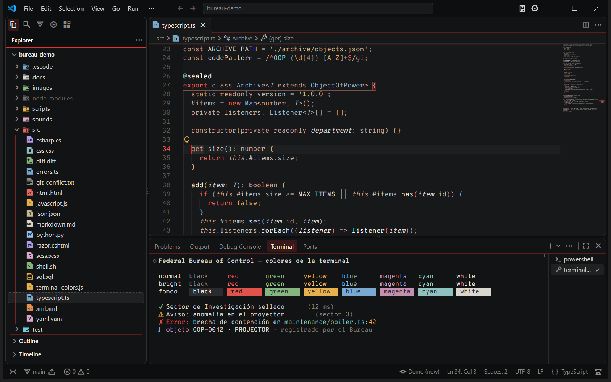

# Bureau Theme — CONTROL-inspired Themes, Icons & Fonts

A complete look for Visual Studio Code inspired by the brutalist world of **CONTROL** and **CONTROL Resonant**: four color themes, file and folder icons, VS Code's own icons redrawn, typography inspired by the games and optional sounds.

*By **Normalxxnavi** · fan-made project, not affiliated with Remedy Entertainment ([disclaimer](#disclaimer)).*


## What's inside

| | |
|---|---|
| **4 color themes** | **CONTROL Dark** (The Oldest House), **CONTROL Black** (OLED), **CONTROL Resonant** (patterned Manhattan) and **CONTROL Astral** (the light Astral Plane) |
| **Bureau Icons** | File and folder icons designed as Bureau dossiers: 498 icons covering 340 file extensions, 284 well-known file names, 84 languages and 278 folder names with their own emblem |
| **Bureau Product Icons** | VS Code's own icons redrawn — activity bar, status bar, panels, trees, title bar, debug toolbar: 160 icons, with the **inverted pyramid** for Git and **the Board** for Copilot and chat |
| **Typography** *(optional)* | Fonts inspired by the games for the editor, terminal and chat, installed only for your user |
| **Sounds** *(optional, off by default)* | Original sound effects for saving, errors, builds, debugging and commits |

## Themes

| Theme | Inspired by | Look |
|---|---|---|
| **CONTROL Dark** | *Control* (2019) — The Oldest House | Warm charcoal concrete, bone-white text, FBC red as the accent. The reference theme. |
| **CONTROL Black** | *Control* (2019) — Black Rock | The *Astral Plane in negative*: near-black background for OLED screens, signage lines, cursor and glows in astral white, FBC red kept for selection and details. |
| **CONTROL Resonant** | *Control Resonant* (2026) — patterned Manhattan | Cold wet-asphalt greys and the Hedron's pale cyan. Following the game's art direction, **red belongs to the Hiss**: it only appears for errors and deletions. |
| **CONTROL Astral** | *Control* (2019) — The Astral Plane | The only light theme: a white void framed by black geometry, with FBC red reserved for small details. High contrast (AAA). |

<table>
  <tr>
    <td></td>
    <td></td>
  </tr>
  <tr>
    <td colspan="2"></td>
  </tr>
</table>

### More than colours: Bureau signage

- **The monolith.** The activity bar, status bar and title bar form a dark block (also in Astral) that holds the editor, the sidebar and the panel. Three depths: monolith < sidebar < editor.
- **Signage headers.** Sidebar titles (*EXPLORER*, *SEARCH*…) are a monolith band with an accent line underneath; sections are separated by thin accent rules.
- **Astral light.** Active elements of the frame glow in pure white, like the light of the Astral Plane.
- **Accent glow.** Floating widgets (Command Palette, suggestions, hovers) and the edge of scrolled content glow with the theme colour: FBC red, the Hedron's cyan or astral white.
- **Editor details.** The current line number, the active indent guide, matching brackets and rulers use the accent; an accent line runs under the tabs; the line-number gutter is a darker concrete band.
- **Chat panels.** Elevated "dossier" bubbles, accent-framed code blocks and monolith avatars.

Design rules:

- **Readability first.** Every text colour is checked against WCAG contrast ratios (body text ≥ 7:1, code ≥ 4.5:1). CONTROL Astral meets stricter AAA targets (body text ≥ 15:1, code ≥ 7:1).
- **Red is used sparingly.** Only control-flow keywords (`if`, `return`, `throw`…) are red in code; declarations (`public`, `const`, `class`…) use a muted tone.
- **Active ≠ broken.** The error colour is never the accent colour, so a squiggle is never confused with an active element.
- Full coverage: 687 UI colour keys (including the *modern UI* of VS Code 1.140), the terminal's 16 ANSI colours, Git, diff/merge editors, bracket pairs and **semantic highlighting** (including C#/Roslyn and Razor).

## Install

1. Install the extension (from the Marketplace or with `code --install-extension bureau-theme-<version>.vsix`).
2. <kbd>Ctrl</kbd>+<kbd>K</kbd> <kbd>Ctrl</kbd>+<kbd>T</kbd> (<kbd>Cmd</kbd>+<kbd>K</kbd> <kbd>Cmd</kbd>+<kbd>T</kbd> on macOS) → **CONTROL Dark**, **CONTROL Black**, **CONTROL Resonant** or **CONTROL Astral**.
3. **Preferences: File Icon Theme** → **Bureau Icons**.
4. **Preferences: Product Icon Theme** → **Bureau Product Icons**.
5. The first time the extension starts it offers the game typography; you can also run **CONTROL: Choose Typography…** at any time.

## Bureau Icons

Every file is a **Bureau dossier**: a solid sheet in the colour of its language, with its folded corner and classification band, and its code (`TS`, `C#`, `{}`…) or a pictogram cut out of it. Every folder is a solid folder in the colour of its category with an **emblem**: `</>` for `src`, a check for `test`, a mountain for `images`, a wave for `sounds`, the pyramid for `.git`, a hex nut for `.vscode`, a cube for `node_modules`, a terminal for `scripts`, a globe for `l10n`, a shield for `auth`…


Coverage: programming languages, web, .NET (`.csproj`, `.sln`, `appsettings.json`…), configuration of the usual tools (Vite, Webpack, ESLint, Prettier, Jest, Vitest, Playwright, Tailwind, Next, Nuxt, Angular…), package managers and lockfiles, Docker and CI files, documents, images, audio, video, fonts, archives, certificates and keys.

Lore details: `.env` files are a **classified, redacted document**, tests carry the **Hedron hexagon**, AI instruction files (`CLAUDE.md`, `AGENTS.md`, `*.prompt.md`…) carry **the Board**, and the root folder of a multi-root workspace is the **Board's inverted pyramid**. All icons have dark and light variants.

## Bureau Product Icons

Redraws the icons VS Code draws itself, with geometric, brutalist glyphs (octagons instead of circles, square dots, thick strokes). They work with the activity bar on the side, on top or at the bottom.


| Where | What changes |
|---|---|
| Activity bar | Explorer (a dossier), Search, Source Control (**the inverted pyramid**), Run and Debug (the Hedron), Extensions (concrete blocks), Testing, Accounts (a Bureau badge), Settings (a hex nut) |
| Status bar | Git branch (**the pyramid**), publish/sync, errors and warnings, remote indicator, notifications (**the Hotline telephone**), Copilot (**the Board**) |
| Panels | New, split, kill (trash), maximize, close, more actions, tasks, terminal profiles, output, debug console, ports |
| Trees and editors | Expand/collapse chevrons, new file/folder, refresh, collapse all, filter, clear, pin, close and dirty markers |
| Title bar | Back/forward, layout toggles, window controls |
| Debugging | Continue, pause, stop, restart, step over/into/out |



Only icons that VS Code identifies by name can be replaced. Extensions that draw their own image (for example Claude Code's logo) keep their icon.

## Typography

*Control* is set in commercial typefaces (Interstate for signage and UI, ITC Avant Garde Gothic for titles, Akzidenz-Grotesk for documents), so they cannot be bundled. The extension includes free alternatives (SIL Open Font License) and offers them the first time it starts:

| Option | Code (editor, terminal, debug console, code in chat) | Text (chat, Markdown preview) |
|---|---|---|
| **Bureau** (*Control*) | **Overpass Mono** — derived from *Highway Gothic*, the road-sign lettering Interstate is based on | **Overpass** |
| **Resonant** (*Control Resonant*) | **Space Mono** — geometric, retro-futuristic | **Space Grotesk** |
| **Follow the theme** | Resonant with CONTROL Resonant, Bureau with the other CONTROL themes, your own font with any other theme | |

- If you own **Interstate Mono** / **Interstate**, the Bureau option uses them first.
- The fonts are installed **only for your user** (no administrator rights). New fonts are loaded when VS Code starts, so restart it once after choosing.
- **Keep my font** restores your previous settings; **CONTROL: Remove Installed Fonts** also deletes the font files.
- VS Code does not allow changing the font of its own interface (menus, tabs).

## Optional sounds

Short sound effects inspired by both games. **Off by default**; every event has its own switch. Turn them on with **CONTROL: Toggle Sounds** and listen to them with **CONTROL: Preview Sounds…**.

| Event | Default | Control pack | Resonant pack |
|---|---|---|---|
| VS Code starts | off | Low concrete hum of the Oldest House | Distant, warped city |
| Switching to a CONTROL theme | on | Old red-phone ring | Hedron pulse |
| Manual save (auto-save is ignored) | off | Rubber stamp | Metallic tick |
| New errors | on | Hiss-like whisper | Whisper with patterned echoes |
| Last error fixed | on | Control Point cleansed | Resonant defeated |
| Task / build succeeded | on | Elevator ding | Rising glass arpeggio |
| Task / build failed | on | Bureau alert | Gravity distortion |
| Terminal command failed | off | Radio static | Glitched static |
| Debugging started | on | Service-weapon transformation | Shape-shifting weapon |
| Breakpoint hit | on | Slide projector | Gravity shift |
| Git commit | on | Typewriter and bell | Metal hit with echoes |

**All sounds are original recreations** synthesized from scratch — no audio, music or voices from the games are included or downloaded. See [`sounds/LICENSES.md`](sounds/LICENSES.md).

### Settings

| Setting | Default | Description |
|---|---|---|
| `bureauTheme.font` | `none` | `bureau`, `resonant`, `auto` (follow the theme) or `none` (keep your font). |
| `bureauTheme.sounds.enabled` | `false` | Master switch for sounds. |
| `bureauTheme.sounds.pack` | `auto` | `auto` follows the theme, or force `control` / `resonant`. |
| `bureauTheme.sounds.volume` | `50` | 0–100. |
| `bureauTheme.sounds.onlyWithControlTheme` | `true` | Stay silent while another theme is active. |
| `bureauTheme.sounds.errorTrigger` | `onSave` | `onSave` or `live`. |
| `bureauTheme.sounds.cooldownMs` | `1500` | Minimum time between sounds; more important ones can interrupt. |
| `bureauTheme.sounds.customFolder` | `""` | Folder with your own `.wav` files (user settings only). |
| `bureauTheme.sounds.events.*` | see above | One switch per event. |

**Custom sounds:** put `.wav` files named `startup.wav`, `theme.wav`, `save.wav`, `error.wav`, `clear.wav`, `build-ok.wav`, `build-fail.wav`, `terminal-fail.wav`, `debug.wav`, `breakpoint.wav` and `commit.wav` in a folder and point `bureauTheme.sounds.customFolder` to it. Only use audio you have the right to use.

**How it plays audio:** VS Code has no audio API for extensions, so the extension uses the system player — a background PowerShell process on Windows, `afplay` on macOS and `paplay`, `pw-play` or `aplay` on Linux. With Remote-SSH, WSL or Codespaces the sounds play on your local machine. Not available in the browser (vscode.dev).

## Recommended settings

```jsonc
{
  "workbench.iconTheme": "bureau-icons",
  "workbench.productIconTheme": "bureau-product-icons",
  "editor.bracketPairColorization.enabled": true,
  "editor.guides.bracketPairs": "active",
  "editor.semanticHighlighting.enabled": true
}
```

Comments, parameters and type parameters are *italic*. To turn italics off:

```jsonc
{
  "editor.tokenColorCustomizations": {
    "[CONTROL Dark][CONTROL Black][CONTROL Resonant][CONTROL Astral]": {
      "textMateRules": [
        {
          "scope": ["comment", "variable.parameter", "entity.name.type.type-parameter", "variable.language", "markup.quote"],
          "settings": { "fontStyle": "" }
        }
      ]
    }
  },
  "editor.semanticTokenColorCustomizations": {
    "[CONTROL Dark][CONTROL Black][CONTROL Resonant][CONTROL Astral]": {
      "rules": { "parameter": { "italic": false }, "typeParameter": { "italic": false }, "*.abstract": { "italic": false } }
    }
  }
}
```

## Tested languages

C#, Razor (`.cshtml`), JavaScript, TypeScript, JSON, HTML, CSS, SCSS, SQL, Markdown, XML, YAML, Python, Bash, diff and Git merge conflicts.

## Known limitations

- Semantic colours depend on each language extension (for C# and Razor, the official C# extension).
- The theme colours the Markdown **editor**; the Markdown **preview** uses its own stylesheet.
- Panels from other extensions (for example AI chat panels) are web views: they only follow the theme colours they choose to use.
- On Linux, sounds need `paplay` (PulseAudio/PipeWire), `pw-play` or `aplay` (ALSA).
- The *terminal command failed* sound requires terminal shell integration.

## Roadmap

- More variants: **Hiss** (aggressive red), **Ashtray Maze**, **Gravity Anomaly**, **Oldest House** (lighter brutalist grey).
- A *Classified* mode that hides the values in `.env` files behind black bars while you share your screen.

See [CHANGELOG.md](CHANGELOG.md) for the release history.

## Credits

Made by **Normalxxnavi**. Fonts: Overpass, Overpass Mono, Space Mono and Space Grotesk (SIL Open Font License, see [`fonts/`](fonts/README.md)). Everything else — colours, icons, glyphs and sounds — is original and released under the MIT license.

## Disclaimer

Fan-made project. Not affiliated with or endorsed by Remedy Entertainment. CONTROL and CONTROL Resonant are trademarks of their respective owners. No game assets (images, logos, audio, music or text) are included.

## License

[MIT](LICENSE)
