<div align="center">

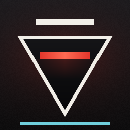

# Bureau — CONTROL Fan Theme

**Brutalist concrete, bone-white signage and FBC red.**<br>
Four VS Code themes inspired by Remedy's *Control* and *Control Resonant*, with matching icons, a terminal prompt and optional sounds.

[](https://marketplace.visualstudio.com/items?itemName=Normalxxnavi.bureau-theme)
[](https://marketplace.visualstudio.com/items?itemName=Normalxxnavi.bureau-theme)
[](https://code.visualstudio.com/)
[](LICENSE)

🌐 **English** · [Español](README.es.md)

</div>

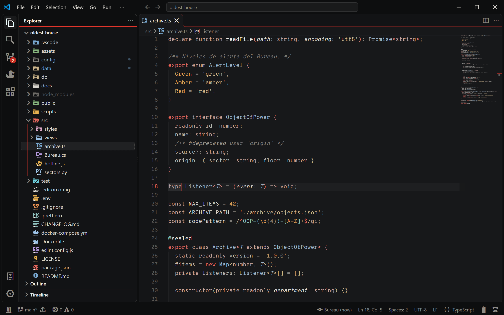

> 🆕 **What's new:** the [Bureau terminal](#terminal), icons redrawn from the game and a much faster start. See the [changelog](CHANGELOG.md).

## 🎨 Four themes

<table>
  <tr>
    <td width="50%"></td>
    <td width="50%">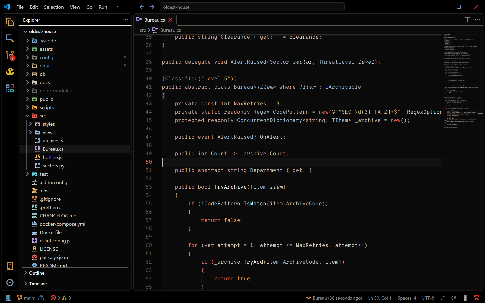</td>
  </tr>
  <tr>
    <td align="center">🏢 <b>CONTROL Dark</b><br><sub>The Oldest House: warm concrete, bone-white text, FBC red</sub></td>
    <td align="center">🖤 <b>CONTROL Black</b><br><sub>True black for OLED screens, astral-white signage</sub></td>
  </tr>
  <tr>
    <td width="50%">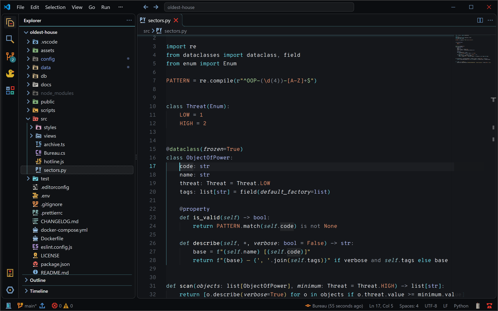</td>
    <td width="50%">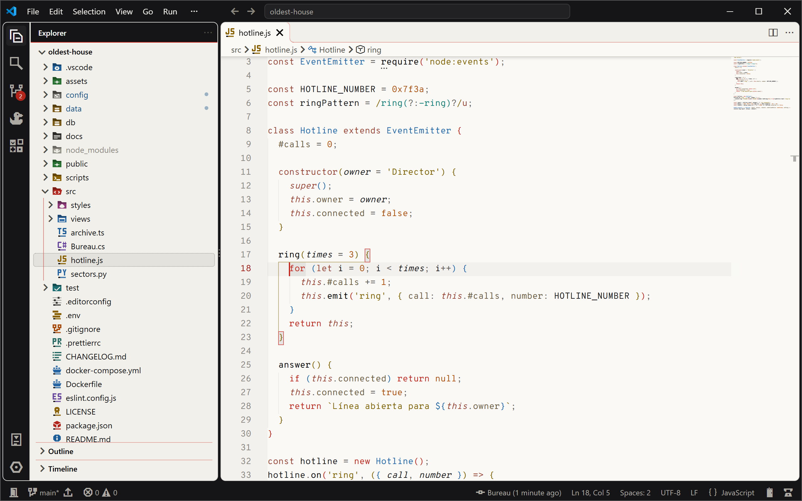</td>
  </tr>
  <tr>
    <td align="center">🌆 <b>CONTROL Resonant</b><br><sub>Patterned Manhattan: wet asphalt, steel blue, resonance cyan</sub></td>
    <td align="center">⚪ <b>CONTROL Astral</b><br><sub>The light theme: a white void framed by black geometry</sub></td>
  </tr>
</table>

## ✨ Features

- 🎨 **687 interface colours per theme**, the 16 terminal colours and semantic highlighting. Every text colour is checked against WCAG.
- 🧪 **Any language**: syntax colours tested against 142 languages, from TypeScript and Python to Zig, Elixir and COBOL.
- 🗂️ **Bureau Icons**: 498 file and folder icons drawn on the 16 px pixel grid, sharp at 100 % scaling.
- 🧩 **Bureau Product Icons**: 350 of VS Code's own icons redrawn from the game, in the theme colour or in **Color**.
- 🖥️ **The Bureau terminal** 🆕: a prompt for PowerShell, cmd, bash, zsh and fish in five styles. No Oh My Posh, no Nerd Fonts.
- 🏛️ **The Oldest House**: the whole theme from one button in the status bar.
- 🎵 **Songmaster jukebox**: what is playing on your computer, with its controls.
- 🕶️ **Classified mode**: redaction bars over your secrets while you share your screen.
- 🔊 **Sound effects** and 🔤 **typography** from the games, optional.
- 🔒 **Private**: no network connections and no telemetry.

<a id="terminal"></a>

### 🖥️ The Bureau terminal

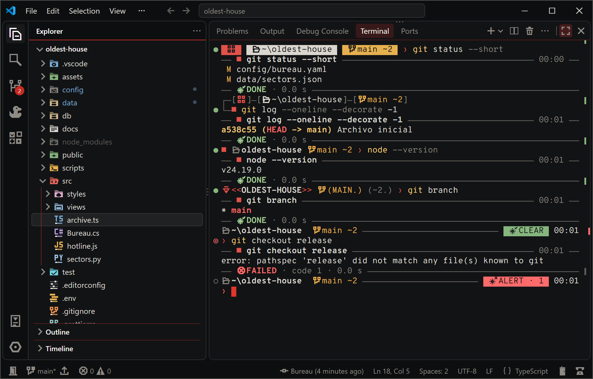

Five prompt styles, told in the Bureau's terms. Off by default: **CONTROL: Choose the Terminal Prompt…**

| Style | What it shows |
|---|---|
| 🪧 **Signage** | Solid blocks like the signs of the Oldest House: system, folder, Git branch, time and error. |
| 📁 **Dossier** | Two lines framed like a case file, ending in the Control Point. |
| ⏺️ **Control Point** | Minimal: the Point, the folder and the branch. The Point empties when a command fails. |
| 📢 **The Board** | `<<THE FOLDER>> (THE BRANCH.)`, and a Board message when the terminal opens. |
| 🚨 **Alert level** | *Clear*, *Anomaly*, *Alert* or *Hiss Incursion* on the right, with the time. |

- 🌿 **Git at a glance**: branch, commits ahead and behind (`↑1 ↓2`), changed files (`~5`), and `git status`, `log` and `diff` in the Bureau colours.
- ⏱️ **A header and a closing line for each command**: `── ■ npm run build ── 12:04 ──` … `── DONE · 3.2 s ──`.
- 🪟 **System icons** drawn on the Bureau grid for Windows, macOS and Linux, from a tiny font the extension installs for you.
- 🚪 **Outside VS Code too**: Windows Terminal, macOS Terminal and the rest, with **CONTROL: Use the Bureau Prompt Outside VS Code**.

### 🗂️ Icons

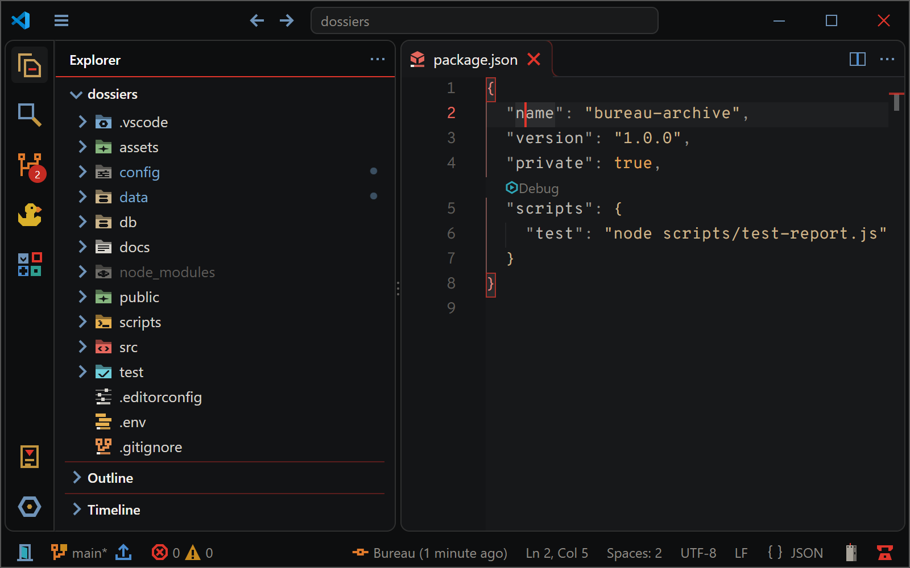

Files carry their code (`TS`, `C#`, `PY`…) over a classification band; folders are coloured by category. The product icons come from the game: the Bureau tape for source control, Jesse's mod slots for extensions, the rubber duck for debugging, the Hedron for testing.

<details>
<summary>🌕 <b>On the light theme</b>, and every object from the game</summary>
<br>

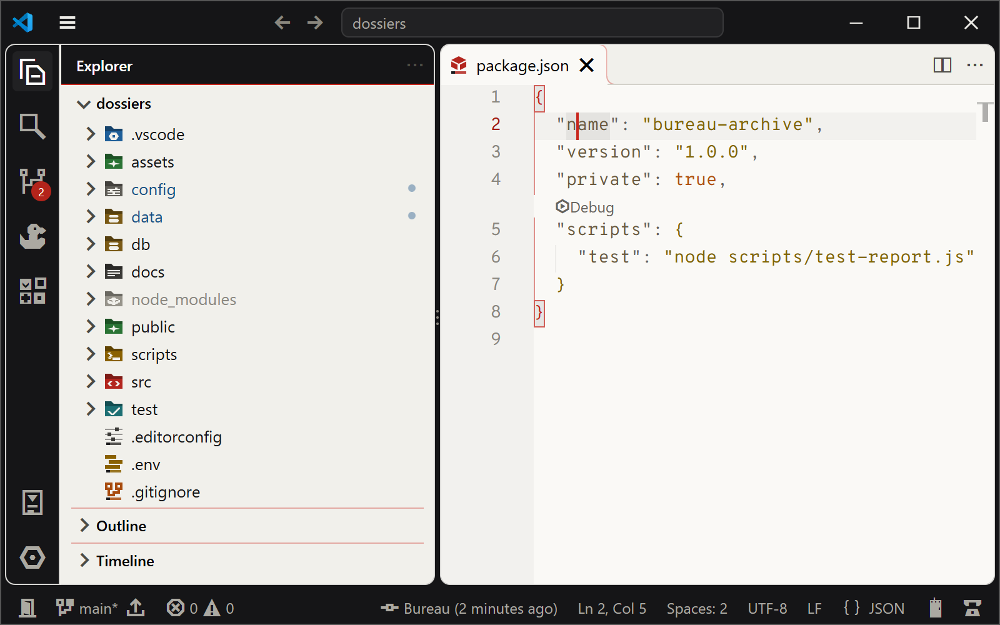

| In VS Code | From the games |
|---|---|
| Explorer | Bureau dossier |
| Source Control | The Bureau tape that links the Control Points, at right angles like the corridors of the Oldest House |
| Git branch | The same tape, with a mark in place of the tip Point for changes, staged changes, conflicts or a deleted branch |
| Run and Debug | The rubber duck |
| Extensions | Jesse's mod slots |
| Testing | The Hedron |
| Copilot and chat | Polaris, crystals around an eye as in the first game |
| Notifications | The Hotline |
| Remote | The Threshold |

</details>

### 🏛️ The Oldest House

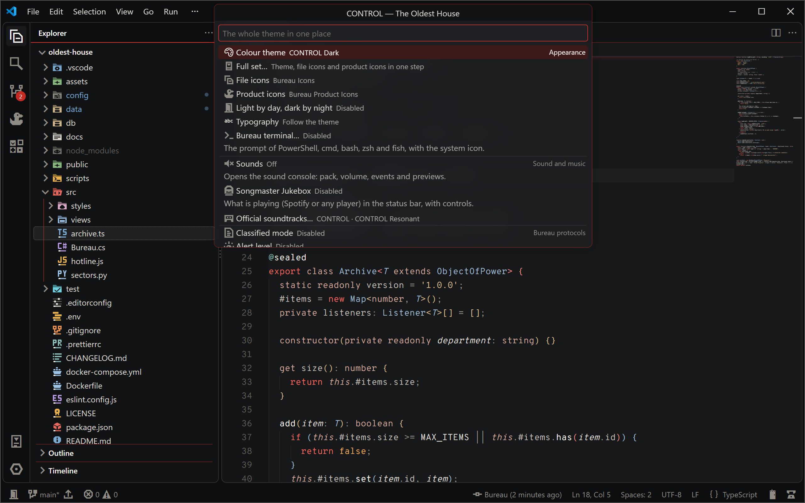

Click the windowless monolith in the status bar to change the theme, the icons, the typography, the terminal, the sounds, the jukebox and the protocols, all in one place.

### 🎵 Songmaster jukebox

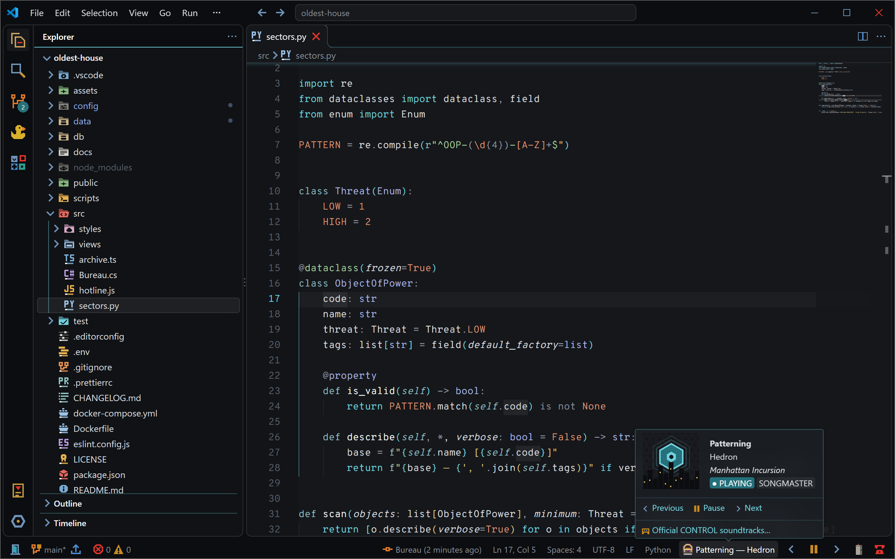

Spotify or **any player** (the browser, Apple Music, VLC…) in the status bar, with previous, play/pause and next. No account and no login: it reads the music from your system. It also opens the official soundtracks of both games in Spotify. Off by default.

### 🕶️ Classified mode and the Bureau protocols

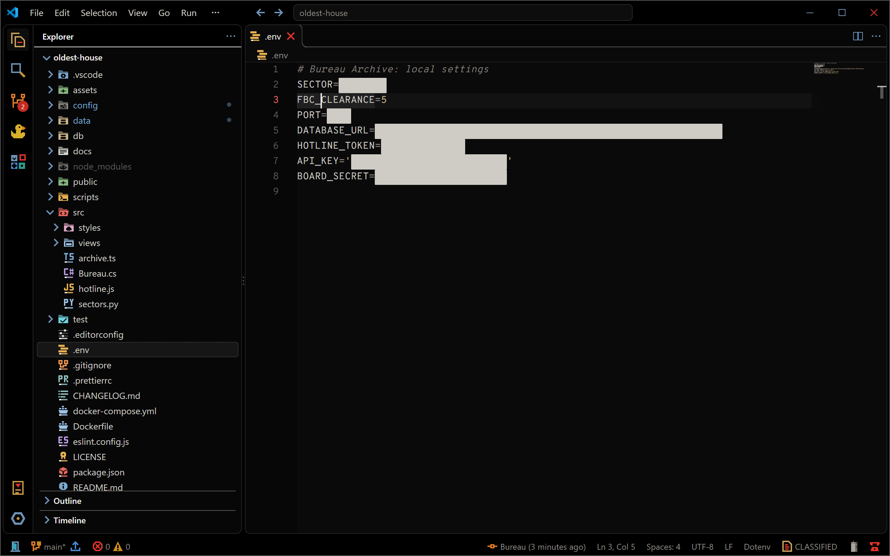

- 🕶️ **Classified mode** covers every value in `.env` files, keys and anything that looks like a secret (`password`, `token`, `apiKey`…). Put the cursor on a line to reveal it; the file never changes.
- 🚨 **Alert level** goes from *Clear* to *Anomaly*, *Alert* and *Hiss Incursion* as warnings and errors pile up.
- 📢 **The Board** speaks `<<IN ITS OWN VOICE.>>` a few times a day, with its 87 messages or yours.

All three are off by default: turn them on in the Oldest House.

### 🔊 Sounds and 🔤 typography

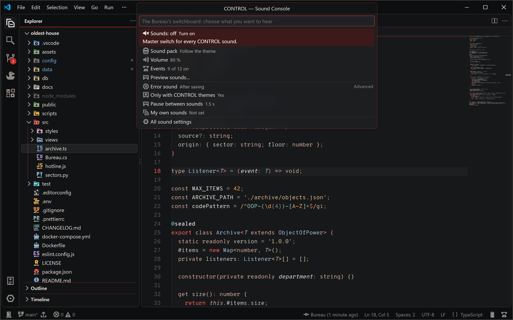

Short sound effects for saving, errors, tasks, debugging and Git commits, in the *Control* or *Resonant* pack, from 0 to 200 % volume. All original, synthesized for this theme. Off by default: **CONTROL: Open Sound Console…**

Free fonts inspired by the games, installed only for your user and removed when you uninstall: **CONTROL: Choose Typography…**

| Option | Code | Text |
|---|---|---|
| **Bureau** | Overpass Mono | Overpass |
| **Resonant** | Space Mono | Space Grotesk |
| **Follow the theme** | Resonant with CONTROL Resonant, Bureau with the others | |

## 📦 Install

1. Install **Bureau — CONTROL Fan Theme** from the Marketplace, or press <kbd>Ctrl</kbd>+<kbd>P</kbd> and run `ext install Normalxxnavi.bureau-theme`.
2. The **welcome guide** opens and sets everything up step by step.
3. Change the theme any time with <kbd>Ctrl</kbd>+<kbd>K</kbd> <kbd>Ctrl</kbd>+<kbd>T</kbd> (<kbd>Cmd</kbd>+<kbd>K</kbd> <kbd>Cmd</kbd>+<kbd>T</kbd> on macOS).

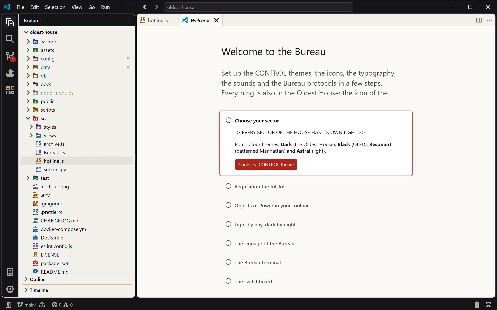

> 💡 **All in one step:** **CONTROL: Apply the Full Set (Theme and Icons)…** applies a theme, Bureau Icons and Bureau Product Icons, and can be undone.<br>
> 🌗 **Light by day, dark by night:** **CONTROL: Follow the System Light/Dark Mode…**

## 🛠️ Make it yours

Change any colour in your `settings.json`, only for the CONTROL theme you name:

```jsonc
"workbench.colorCustomizations": {
  "[CONTROL Dark]": {
    "editor.background": "#101113",   // a darker editor
    "statusBar.background": "#C42B22" // an FBC-red status bar
  }
}
```

Comments and parameters are *italic*. To turn italics off:

```jsonc
"editor.tokenColorCustomizations": {
  "[CONTROL Dark][CONTROL Black][CONTROL Resonant][CONTROL Astral]": {
    "textMateRules": [{ "scope": ["comment", "variable.parameter", "entity.name.type.type-parameter", "variable.language", "markup.quote"], "settings": { "fontStyle": "" } }]
  }
},
"editor.semanticTokenColorCustomizations": {
  "[CONTROL Dark][CONTROL Black][CONTROL Resonant][CONTROL Astral]": {
    "rules": { "parameter": { "italic": false }, "typeParameter": { "italic": false }, "*.abstract": { "italic": false } }
  }
}
```

<details>
<summary>⚙️ <b>All settings</b></summary>
<br>

| Setting | Default | Description |
|---|---|---|
| `bureauTheme.statusBarItem` | `true` | Show the Oldest House icon in the status bar. |
| `bureauTheme.font` | `none` | `bureau`, `resonant`, `auto` (follow the theme) or `none`. |
| `bureauTheme.sounds.enabled` | `false` | Master switch for sounds. |
| `bureauTheme.sounds.pack` | `auto` | `auto`, `control` or `resonant`. |
| `bureauTheme.sounds.volume` | `80` | 0–200 (above 100, amplified with a soft limiter). |
| `bureauTheme.sounds.onlyWithControlTheme` | `true` | Stay silent while another theme is active. |
| `bureauTheme.sounds.errorTrigger` | `onSave` | `onSave` or `live`. |
| `bureauTheme.sounds.cooldownMs` | `1500` | Minimum time between sounds. |
| `bureauTheme.sounds.customFolder` | `""` | Folder with your own `.wav` files (user settings only). |
| `bureauTheme.sounds.events.*` | | One switch per event: start, theme switch, save, typing, errors, tasks, terminal command failed, debugging, Git commit. |
| `bureauTheme.classified.enabled` | `false` | Classified mode. |
| `bureauTheme.classified.files` | `.env`, `*.pem`, `appsettings*.json`… | Files where Classified mode applies (glob patterns). |
| `bureauTheme.classified.keywords` | `password`, `token`, `apikey`… | Words that mark a value as secret (plain words, not regular expressions). |
| `bureauTheme.alertLevel.enabled` | `false` | Bureau alert level in the status bar. |
| `bureauTheme.alertLevel.incursionThreshold` | `10` | Errors from which the level is *Hiss Incursion*. |
| `bureauTheme.board.comments` | `false` | Board comments in the status bar. |
| `bureauTheme.board.random` | `false` | Random Board messages during the day (user settings only). |
| `bureauTheme.board.timesPerDay` | `3` | How many random messages a day. |
| `bureauTheme.board.hours` | `""` | Hours for them, for example `09:00-18:00` (empty: any time). |
| `bureauTheme.board.display` | `notification` | `notification`, `statusBar` or `both`. |
| `bureauTheme.board.source` | `all` | `all` (the Board's and yours), `board` or `custom`. |
| `bureauTheme.board.customMessages` | `[]` | Your own messages (user settings only). |
| `bureauTheme.music.enabled` | `false` | Songmaster jukebox (user settings only). |
| `bureauTheme.music.source` | `any` | `any` player or only `spotify`. |
| `bureauTheme.music.controls` | `true` | Previous, play/pause and next buttons next to the song. |
| `bureauTheme.terminal.prompt` | `off` | `signage`, `dossier`, `controlPoint`, `board`, `alertLevel` or `off` (user settings only, like the rest of `bureauTheme.terminal.*`). |
| `bureauTheme.terminal.classified` | `false` | Cover the prompt of each command you run with a redaction bar. |
| `bureauTheme.terminal.icons` | `true` | System and segment icons (Bureau Prompt Icons). |
| `bureauTheme.terminal.windowsIcon` · `macosIcon` · `linuxIcon` | `controlPoints` · `command` · `tux` | The system icon; `house`, `apple` and `tuxMop` are the alternatives. |
| `bureauTheme.terminal.commandFrame` | `true` | A header and a closing line for each command you run. |
| `bureauTheme.terminal.gitColors` | `true` | Git output in the Bureau colours (yours come first). |
| `bureauTheme.terminal.newTerminals` | `true` | With the prompt on, the Bureau profile is the default of VS Code. |
| `bureauTheme.terminal.shell` | `auto` | `auto` (your previous default terminal), `pwsh`, `powershell`, `cmd`, `bash`, `zsh` or `fish`. |

</details>

<details>
<summary>⚠️ <b>Known limitations</b></summary>
<br>

- Semantic colours depend on each language extension (for C# and Razor, the official C# extension). Panels drawn by other extensions (web views) only use the theme colours they choose to.
- On Linux, sounds need `paplay`, `pw-play` or `aplay`; the *terminal command failed* sound needs shell integration.
- Classified mode draws bars over the editor: values can still be seen where it does not reach (search results, the minimap, hovers of other extensions), and VS Code shows a file for an instant before the bars are drawn. Turn it on before opening the file you want to protect.
- The jukebox shows what the system reports: on macOS only Spotify and Music, without album covers; on Linux it needs `gdbus` and shows the cover only when the player saves it as a local file of up to 48 KB.
- The Bureau terminal: cmd's prompt is fixed text (no Git branch, error or Classified), and Classified works in PowerShell, zsh and fish, not bash. The icons need a terminal with a fallback font: VS Code, Windows Terminal and most Linux terminals have one; the classic Windows console does not (turn off `bureauTheme.terminal.icons`), and in macOS Terminal or iTerm2 you may have to choose *Bureau Prompt Icons* as the font for non-ASCII characters. The first time, restart VS Code if you see boxes instead of icons. If Windows PowerShell does not allow scripts (`Restricted`), the prompt still works in VS Code, but outside VS Code your `profile.ps1` does not run.
- Fonts on Windows: a font that is still open when you uninstall stays, unused, in `%LOCALAPPDATA%\Microsoft\Windows\Fonts` (its files start with `BureauTheme-`); you can delete it later.

</details>

## 🔒 Privacy and security

No network connections and no telemetry. The sounds use the system audio player, the fonts go to your user fonts folder, the jukebox only reads the song your system reports, and the Bureau terminal only touches your shell profiles when you ask it to. See [SECURITY.md](SECURITY.md).

## 🙌 Credits

Made by **Normalxxnavi** · [Changelog](CHANGELOG.md) · [MIT license](LICENSE). Fonts: Overpass, Overpass Mono, Space Mono and Space Grotesk (SIL Open Font License, see [`fonts/`](fonts/README.md)). Colours, icons and sounds are original.

<sub>*Beta · Unofficial fan work, not approved or endorsed by Remedy Entertainment Plc or its affiliates. CONTROL and CONTROL Resonant are trademarks of their respective owners and are only used to describe what inspired this theme. No game assets are included. Windows, macOS and Linux are trademarks of their respective owners.*</sub>
